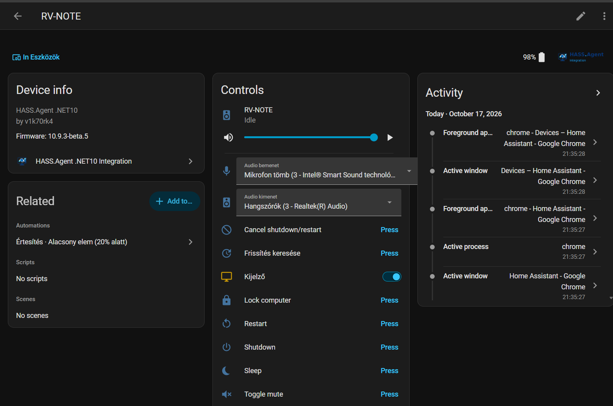
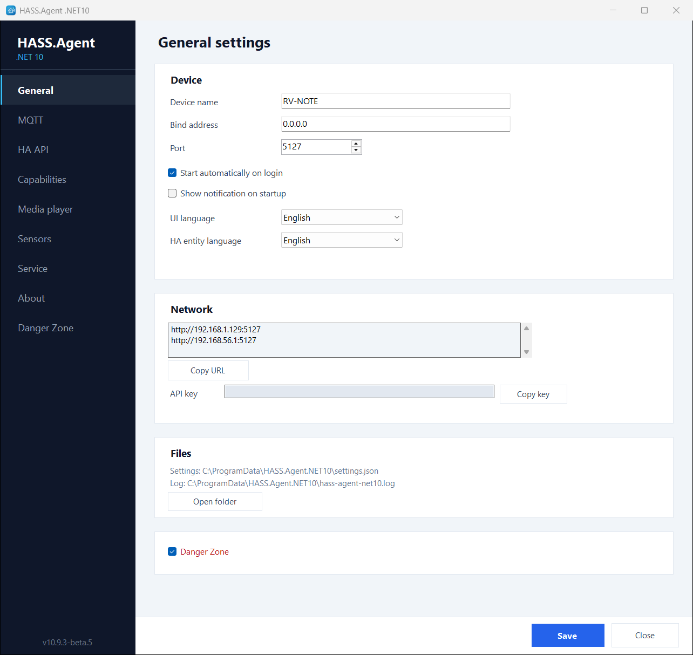

# HASS.Agent .NET10


[](https://www.bestpractices.dev/projects/15316)
[](https://scorecard.dev/viewer/?uri=github.com/v1k70rk4/HASS.Agent.NET10)
[](https://v1k70rk4.github.io/HASS.Agent.NET10/)
[](https://ko-fi.com/v1k70rk4)


A modern Windows companion app for Home Assistant.

🌐 **[Website & screenshots](https://v1k70rk4.github.io/HASS.Agent.NET10/)**

> ⭐ **Enjoying HASS.Agent?** Please star this repo — and the [Home Assistant integration](https://github.com/v1k70rk4/HASS.Agent.NET10-Integration) too. It helps others find the project and keeps it going!
>
> ☕ If HASS.Agent saved you an evening of tinkering, you can [buy me a coffee on Ko-fi](https://ko-fi.com/v1k70rk4). Everything stays free — it just helps cover things like the code signing certificate.

**HASS.Agent .NET10** began as a fork of the classic [HASS.Agent](https://github.com/LAB02-Research/HASS.Agent) and has grown into a project of its own: a lightweight .NET 10 client built for current Windows desktops. The original client was a .NET 6-era application; this one focuses on a smaller, cleaner runtime, Home Assistant integration via MQTT or WebSocket API, Windows 11-friendly UX, and a split tray app/system service model.

It is designed for Windows PCs you want to observe and control from Home Assistant: media playback, notifications, sensors, shutdown/restart, command buttons, and rich machine state.

The .NET10 line starts at **version 10.0.0**. The classic client is a separate program: if you want to stay with it, it is still available from its own project, and the integration keeps a [`legacy` branch](https://github.com/v1k70rk4/HASS.Agent.NET10-Integration/tree/legacy) for it. Thinking about switching? See [Coming from HASS.Agent](docs/getting-started/migrating.md).

> **Stable:** [10.10.2](https://github.com/v1k70rk4/HASS.Agent.NET10/releases/latest) &nbsp;·&nbsp; [What changed](#what-changed) &nbsp;·&nbsp; [Full changelog](CHANGELOG.md)

---

## Install

### Requirements

- Windows 10 version 2004 / build 19041 or newer
- Windows 11 recommended
- x64 Windows
- Home Assistant with **MQTT broker** (recommended, e.g. Mosquitto) **or HA API** (WebSocket, e.g. via Nabu Casa)
- The companion Home Assistant integration:
  [v1k70rk4/HASS.Agent.NET10-Integration](https://github.com/v1k70rk4/HASS.Agent.NET10-Integration) —
  **version 10.6.7 or newer**; the sensors added in 10.7.1 need integration **10.7.0** to appear in
  Home Assistant (the agent and the integration are released with matching version numbers, so keep
  them in step)

Windows versions older than Windows 10 2004 are intentionally blocked. The app targets `net10.0-windows10.0.19041.0` and uses modern Windows APIs for notifications, media sessions, services, sensors, and desktop state.

If you download a published self-contained build, you do **not** need to install the .NET runtime separately. If you want to build from source, install the **.NET 10 SDK**.

### Quick Start

1. Install the Home Assistant integration, [v1k70rk4/HASS.Agent.NET10-Integration](https://github.com/v1k70rk4/HASS.Agent.NET10-Integration). It is in the **HACS default store**, so no custom repository is needed: open HACS, search for **HASS.Agent** (or use the button), download it and restart Home Assistant.

   [](https://my.home-assistant.io/redirect/hacs_repository/?owner=v1k70rk4&repository=HASS.Agent.NET10-Integration&category=integration)
2. Install the Windows app with winget:

   ```powershell
   winget install v1k70rk4.HASSAgentNET10
   ```

   Or download the signed installer from [Releases](https://github.com/v1k70rk4/HASS.Agent.NET10/releases) (see [Code Signing](#code-signing)), or [build from source](docs/development.md#build-from-source).
3. Run the installer or start `HASS.Agent.NET10.exe` directly.
4. Open the tray icon and go to settings.
5. On the **MQTT** page, enable MQTT and enter your broker address and credentials. Whoever can log in to the broker can send this PC commands, so keep that login to yourself ([more](docs/connection/mqtt.md)).
   Alternatively, on the **HA API** page, enable the WebSocket connection to Home Assistant (useful for remote access via Nabu Casa or when no MQTT broker is available).
6. On the **Capabilities** page, choose which features are handled by the tray app vs. the service.
7. On the **Sensors** page, enable built-in sensors and add custom sensors.
8. Optionally install the Windows service from the **Service** page.
9. On MQTT the PC turns up on its own under **Discovered** in **Settings → Devices & services** of Home Assistant; click **Add** there. Over the HA API the first PC is added by hand, with the button below and then **HA API (WebSocket)**; once the integration has a device, further PCs on the HA API are discovered as well.

   [](https://my.home-assistant.io/redirect/config_flow_start/?domain=hass_agent)

The integration creates the Home Assistant entities from what the agent advertises, so what you switch on or off in the settings appears and disappears there on its own.

### Installer

The setup package is built with [Inno Setup](https://jrsoftware.org/isinfo.php). It is also what winget installs and upgrades (`winget install v1k70rk4.HASSAgentNET10`, `winget upgrade v1k70rk4.HASSAgentNET10`). winget runs it without its wizard pages, showing only the progress, so the options below keep their defaults on a first install (start on login on, the rest off) and their earlier choices on an upgrade; add `--interactive` to go through the wizard. Options during install:

- **Desktop icon** (optional)
- **Start automatically on login** (default: enabled, sets a registry Run key)
- **Install system service** (optional)
- **Clean install** (removes existing settings, API key, and log files — useful for a fresh start)
- **Who may use it** (first install only): *Only me* or *Every user of this PC*, see [Who May Use It on This PC](docs/features/users.md)

The installer automatically configures a **Windows Firewall** rule (Private profile, TCP port 5115) for the Local HTTP API, so manual firewall setup is not needed if you turn that on (it is off by default).

During upgrades the installer stops the running tray app, stops the system service if installed, replaces the files, reinstalls/starts the service, and restarts the tray app. On uninstall the firewall rule is removed automatically, and you are asked whether the settings (with the tokens and passwords in them) should go too.

---

## Features

| | What it does | Details |
|---|---|---|
| <a id="notifications"></a>**Notifications** | Home Assistant notifications as Windows notifications or in the app's own always-visible window, with pictures, buttons and text fields; what is pressed and typed comes back to Home Assistant as an event. | [Notifications](docs/features/notifications.md) |
| <a id="media-player"></a>**Media player** | The active Windows media session as a `media_player`: title, play / pause, skip, seek, volume, cover art, TTS and announcements; its own page in the app. | [Media Player](docs/features/media-player.md) |
| <a id="sensors"></a><a id="built-in-sensors"></a>**Sensors** | Built-in system sensors (CPU, memory, drives, network, battery, session, GPU, camera and microphone in use, and more), each with its own polling profile. | [Sensors](docs/sensors/index.md) |
| <a id="custom-sensors"></a>**Custom sensors** | Your own: a process, a service, a drive, an attribute of a built-in sensor, the output of a command or script, a LibreHardwareMonitor value. | [Custom Sensors](docs/sensors/custom.md) |
| <a id="system-commands"></a>**System commands** | Lock, sleep, monitor off, volume, shutdown, restart as buttons and a service call; Hibernate and Log off (off by default). | [System Commands](docs/commands/index.md) |
| <a id="custom-commands"></a>**Custom commands** | Your own buttons: programs, PowerShell scripts, key presses, links, popup windows. | [Custom Commands](docs/commands/custom.md) |
| **Dashboard popup** | A Home Assistant dashboard, or any web page, in a small window above the tray. | [Dashboard Popup](docs/features/dashboard-popup.md) |
| **Display and audio** | The screen as a light in Home Assistant, the default audio device as a select, the volume of a single app. | [Display and Audio](docs/features/display-and-audio.md) |
| **Hotkeys** | A named key combination becomes an event in Home Assistant, to start automations from the keyboard. | [Hotkeys](docs/features/hotkeys.md) |
| <a id="windows-service"></a>**Windows service** | The same program as a system service, for what should work with nobody logged in. | [Windows Service](docs/features/windows-service.md) |
| <a id="updating-from-home-assistant"></a>**Updates from Home Assistant** | An update entity with a working Install button; silent when the service is installed; only installers signed by the publisher are run. | [Updating](docs/features/updates.md) |
| **Who may use it** | The settings, with the Home Assistant token and the commands, for every user of the PC or only for the ones you tick. | [Who May Use It](docs/features/users.md) |
| **Kiosk mode** | The tray app runs for the users of a kiosk PC, who cannot open, change or close it; it comes back when it is closed. | [Kiosk Mode](docs/features/kiosk.md) |
| <a id="danger-zone"></a>**Danger Zone** | Opt-in toolbox: MQTT cleanup, live monitor, debug log, backup / restore, factory reset, beta updates. | [Danger Zone](docs/features/danger-zone.md) |
| <a id="connection-modes"></a><a id="home-assistant-integration"></a>**Connection** | MQTT, the Home Assistant WebSocket API, or both with automatic failover; a notification-only local HTTP API as a fallback. | [Connection Modes](docs/connection/index.md) |

<p align="center"></p>

<p align="center"></p>

## Documentation

The full documentation is the website, **[v1k70rk4.github.io/HASS.Agent.NET10](https://v1k70rk4.github.io/HASS.Agent.NET10/)**, built from the pages under [`docs/`](docs/):

- [Get started](docs/getting-started/index.md): install, the installer and winget, security and privacy, [coming from HASS.Agent](docs/getting-started/migrating.md)
- [Features](docs/features/index.md): notifications, media player, dashboard popup, display and audio, hotkeys, Windows service, updates, who may use it, kiosk mode, Danger Zone
- [Commands](docs/commands/index.md): system commands and [custom commands](docs/commands/custom.md), with the key names
- [Sensors](docs/sensors/index.md): the built-in sensors, their [attributes](docs/sensors/attributes.md) and [polling profiles](docs/sensors/profiles.md), [custom sensors](docs/sensors/custom.md)
- <a id="mqtt-topics"></a><a id="ha-api-websocket-events"></a><a id="local-http-api"></a><a id="windows-firewall"></a>[Connection](docs/connection/index.md): connection modes, [MQTT](docs/connection/mqtt.md), [HA API](docs/connection/ha-api.md), the [local HTTP API](docs/connection/local-api.md) and the firewall rule
- <a id="build-from-source"></a><a id="minimal-development-setup"></a>[Building and development](docs/development.md): build from source, tests, GitHub Actions, the website
- [Contributing](CONTRIBUTING.md): reporting bugs, sending pull requests
- [Changelog](CHANGELOG.md): every release
- [Home Assistant integration](https://github.com/v1k70rk4/HASS.Agent.NET10-Integration): entities, services, events

---

## Code Signing

Starting with 10.6.8, the release assets (`HASS.Agent.NET10-Setup-<version>.exe`, its uninstaller, and `HASS.Agent.NET10.exe` in the zip) are signed with a Certum *Open Source* code signing certificate:

| | |
|---|---|
| Issued to | `Open Source Developer Viktor Révész` |
| Issued by | `Certum Code Signing 2021 CA` |
| SHA-1 thumbprint | `0C09522639318AF1069507568599DFC5B7F86EE4` |
| Timestamp | `time.certum.pl` (the signature stays valid after the certificate expires) |

To check a download, open its **Properties → Digital Signatures** tab, or from the Windows SDK:

```powershell
signtool verify /pa /v HASS.Agent.NET10-Setup-10.6.8.exe
```

Signing happens on the maintainer's machine through SimplySign, unlocked with a one-time code from the SimplySign app; the private key lives in Certum's cloud HSM and is never exported. The GitHub Actions build itself is unsigned — the signed files replace its assets on the release. A certificate this new has no SmartScreen reputation yet, so Windows may still show a *"Windows protected your PC"* prompt for a while; the publisher name on that prompt is what confirms the file is genuine.

From 10.9.0 on, every release also carries a [Sigstore](https://www.sigstore.dev/) signature per asset (`<asset>.sigstore.json`). A workflow of this repository makes it once the release is out: it checks that the file carries the Certum signature above, then signs it with the workflow's GitHub identity, without any key to keep. It shows that the file is the one this repository published, and it can be checked on any system with [cosign](https://docs.sigstore.dev/cosign/system_config/installation/):

```bash
cosign verify-blob HASS.Agent.NET10-Setup-<version>.exe \
  --bundle HASS.Agent.NET10-Setup-<version>.exe.sigstore.json \
  --certificate-oidc-issuer https://token.actions.githubusercontent.com \
  --certificate-identity-regexp '^https://github\.com/v1k70rk4/HASS\.Agent\.NET10/\.github/workflows/sign-release\.yml@'
```

## Privacy Policy

This program will not transfer any information to other networked systems unless specifically requested by the user or the person installing or operating it.

HASS.Agent .NET10 communicates only with:

- the **Home Assistant instance and/or MQTT broker configured by the user**, to provide its core functionality,
- the **GitHub API** (`api.github.com` / `github.com`), to check for application updates and download release assets.

No telemetry, analytics, or usage data is collected or transmitted.

---

## What Changed

### 10.10.2

A translation release: the app's texts in a file per language, with Simplified Chinese as the first language from a translator, a Drive space sensor with every drive by its letter, and an update check that says when it failed. Works with the Home Assistant integration **10.6.7** or newer; the Drive space sensor needs the integration **10.10.2**, out at the same time. Signed release.

**Sensors**

- **Drive space**, a new built-in sensor: the space on every drive with a letter, fixed ones (USB disks included) and removable ones with something in them, keyed by the letter in the attributes: `drive_space.D.free_gb`, `D.used_gb`, `D.total_gb`, `D.used_percent`, `D.free_percent`, `D.label`, `D.file_system`, `D.removable`. A sensor made on D: stays on D: however many USB sticks come and go. The value is how full the system drive is, always that one, and `system` says which letter it is. The Attributes button makes the sensors for every drive, named with the letter. Network drives are left out. The custom **Disk free space** type is no longer offered for a new sensor; one made before keeps working. Needs the integration 10.10.2 or newer. Requested in [#143](https://github.com/v1k70rk4/HASS.Agent.NET10/issues/143).

**Translations**

- **Translations in a file per language.** The texts of the app are in `en.json` and `hu.json` now, instead of C# code. A new language is a new file: it shows in the language lists, and a Windows set to that language picks it. A translator can try a language without building the app: a file in `%LOCALAPPDATA%\HASS.Agent.NET10\languages` is read by the tray app of that Windows user, checked against English first (a text with other `{0}`-style placeholders than the English one, or a stray brace, is left out, and the app keeps what it had for it: the built-in translation, or English). See [Translating the app](docs/translating.md).
- **Simplified Chinese.** 中文(简体), translated by @natsu-tsuki in [#132](https://github.com/v1k70rk4/HASS.Agent.NET10/pull/132), [#140](https://github.com/v1k70rk4/HASS.Agent.NET10/pull/140) and [#147](https://github.com/v1k70rk4/HASS.Agent.NET10/pull/147), thank you! A Windows set to Chinese picks it, or choose it under **UI language** on the General page.
- **A `todo` list in a language file's header**, the keys waiting for the translator: new texts in English, and texts put together from the translator's own words for them to check. See [Translating the app](docs/translating.md).
- **Key press commands take full-width punctuation.** A Chinese or Japanese input method writes `ctrl+c，ctrl+v` with a full-width comma, which made one combination with an unknown key of it. `，`, `、` and the ideographic space now separate combinations like a space or a comma, and `＋` joins keys like `+`, in key press commands and in the hotkey editor.
- **A longer translation is not cut off.** A check box whose text is longer than the English one wraps, with the box at its first line, instead of ending at the edge of the card; the fast sensors box on the Danger Zone page sits at the first line of its text too.
- **Texts that were English in every language can be translated**: the Tray / Service columns of the system commands, the sensors and the custom commands, and the state and start type on the Service page, which showed Windows' own `Running` and `START_TYPE : 2 AUTO_START`.
- **No English left on a Hungarian app.** The note shown to a user the settings are limited away from is in the language of Windows, as that user cannot read the settings that name the app's language; the last messages written into the code (already running, settings not loaded, Local API not started, why an administrator run did not go as asked) come from the language files; and the Hungarian texts no longer say "tray app" or "service" in English.

**Also in this release**

- **An update check that fails says so.** When Home Assistant asked for an update and the app could not get the list of releases from GitHub, it answered that there was no update and wrote nothing to the log. That is what happened during a GitHub outage on 22 October, when GitHub answered with an empty list for hours. An install request from Home Assistant, the service's silent install and **Check for updates** on the About page now log why the check failed, and Home Assistant gets a notification that the update could not be checked. An empty answer is explained in the log, with GitHub's status page (https://www.githubstatus.com) to look at; the app itself still talks to GitHub's API only. When there is no newer release, or a release has no installer, the log says that too.
- **Danger Zone: Users of this PC has a row of its own.** The note shown to a user who is left out, the notice in Home Assistant and the docs all send people to "Danger Zone, Users of this PC", but it was a button on the Backup / restore view. The Backup / restore view follows the window now: its note wraps and a button that does not fit goes below.

<details>
<summary><b>10.10.1 — hotfix</b> and <b>10.10.0</b></summary>

### 10.10.1 — hotfix

- **Fixed: on a domain-joined PC, administrators were reported to Home Assistant as users who are not.** Reported in [#119](https://github.com/v1k70rk4/HASS.Agent.NET10/issues/119).

### 10.10.0

A feature release: a system health pack of sensors, fast sensors down to 1 second and a polling profile of your own per sensor, a Media player page with announcements that are heard, a name of your own above the notifications, a security round with its recheck, and a handful of fixes. Works with the Home Assistant integration **10.6.7** or newer; the announcements, the Drive health sensor, the device classes of custom sensors and the move of the two renamed sensor keys need the integration **10.10.0**, out at the same time (an older integration keeps the renamed sensors by their old keys). Signed release.

**Sensors**

- **Drive health**, a new built-in sensor from the Windows service: Windows' own verdict on the drives from their SMART data (`healthy`, `warning`, `unhealthy`, the worst of them as the value), with every drive in the attributes (`drives[N].name`, `health`, `temperature`, `temperature_max`, `power_on_hours`, `bus`, `media`) and the system drive's temperature as `temperature`, one attribute sensor away from a °C entity. NVMe drives report the temperature and its highest value, a SATA drive the temperature and the power-on hours when its controller passes them on, USB enclosures nothing; a field a drive does not report is left out. Service only, since reading it needs administrator rights. Needs the integration 10.10.0 or newer. Requested in [#107](https://github.com/v1k70rk4/HASS.Agent.NET10/issues/107).
- **Fast sensors down to 1 second.** The fast interval goes to 5 seconds on the Capabilities page (10 stays the default); the **Fast sensors below 5 seconds** switch on the Danger Zone page unlocks 1–4 seconds, with a note on what that means for the traffic and for Home Assistant's recorder, which writes a row at every change: a sensor you want every second but not in the history goes on the recorder's exclude list. Requested in [#108](https://github.com/v1k70rk4/HASS.Agent.NET10/issues/108).
- **The polling profile of a built-in sensor is yours to choose**: fast, normal or hourly in the Profile column of the Sensors page (GPU usage on fast, CPU usage on normal, whatever suits the PC); push-driven and startup sensors keep theirs. The three intervals stay global, the choice is which one a sensor follows. A custom attribute sensor on a faster profile refreshes the shared read at its own pace, while the built-in sensor still shows Home Assistant its value and attributes at its own: an hourly GPU usage stays hourly in the recorder even with an adapter's load wanted every second.
- **A push event refreshes the push-driven sensors only.** A volume change, a lock or a media event used to re-read every fast and normal sensor along with it, so on a PC playing media the uptime, the GPU or the drive health arrived far more often than their profile says. Now such a read takes the push-driven sensors alone; the clock-driven ones keep their own pace. Uptime moved to the normal profile (every 60 seconds instead of every fast cycle): its value changes with every tick, so on the fast profile it wrote a new row to the recorder at every cycle for nothing.
- **GPU usage per GPU.** On a PC with two GPUs (an integrated one and a graphics card) the sensor's value and its top-level `engines` and memory follow whichever GPU is busiest at each reading, so they could move from one to the other. Each entry of `adapters[N]` now has its own `usage`, `engines` (3D, video and the rest) and memory, so `gpu_usage.adapters[1].engines.3d` follows one card; `gpu_usage.name` says which GPU the main value follows. Requested in [#99](https://github.com/v1k70rk4/HASS.Agent.NET10/issues/99). See [GPU usage with more than one GPU](docs/sensors/attributes.md).
- **Gigabytes next to megabytes, and totals.** `memory_dedicated_gb`, `memory_shared_gb` and `adapters[N].memory_gb`, `memory_dedicated_gb`, `memory_shared_gb` on GPU usage, one decimal; the `_mb` attributes stay, so sensors built on them keep working. `memory_usage` has `total_gb`, `used_gb`, `available_gb`; both system drive sensors have `drive`, `total_gb`, `used_gb`, `free_gb`. Requested in [#107](https://github.com/v1k70rk4/HASS.Agent.NET10/issues/107).
- **Two sensor keys lost the unit in their name: `system_drive_free_gb` is `system_drive`, `memory_available_mb` is `memory_available`.** With the totals in the attributes a key with a unit in it read oddly: `system_drive_free_gb.total_gb`. Nothing changes in Home Assistant: the integration 10.10.0 moves the entity over to the new key, with its entity ID, its history and its statistics, and an older integration keeps its entity because the app still sends and advertises the old key next to the new one. An attribute sensor made on the old path follows the rename on its own. Raised in [#107](https://github.com/v1k70rk4/HASS.Agent.NET10/issues/107).
- **The attribute list follows this PC.** The Attributes button and the editor's list offer `adapters[1]`, `displays[1]`, `drives[1]` and so on for every item the sensor last reported, instead of `[0]` only; the second one's sensor gets a 2 after its name. An attribute sensor made from the list gets its unit (°C for temperatures, h for hours, GB / MB for memory, % for loads), and it can only be ticked for a role that reads its built-in sensor (the drive health for the service, the active window for the app).
- **Custom sensors tell Home Assistant what they measure**: a unit of °C, GB, MB/s, h, W, V, A or MHz brings the matching device class (temperature, data size, data rate, duration, power, voltage, current, frequency), so a °C sensor shows as °F where that is the custom, history included, and the unit can be changed on the entity. Also for LibreHardwareMonitor sensors; per-app volumes from the list get % too. Needs the integration 10.10.0 or newer.
- **Several rows at once on the Sensors page**: Shift and Ctrl pick several custom sensors, and **Remove** and **Test** work on all of them (removing more than one asks first). Custom commands and hotkeys get the multi-row **Remove** too.
- **Fixed: LAN IP could show the address of a virtual adapter.** It took the first adapter Windows listed, often a VirtualBox, Hyper-V, WSL, Docker or VPN one. It now takes the adapter Windows routes through, and `network_address.addresses[N]` lists that one first, then those with a gateway, then the rest. A custom sensor on `addresses[0]` may therefore show another adapter than before: the real one. Reported in [#100](https://github.com/v1k70rk4/HASS.Agent.NET10/issues/100).
- **Fixed: Session locked went back to off a few seconds after locking.** The sensor took a locked session to be one whose input desktop the app cannot open. On Windows 11 the lock screen shows on the user's own desktop, so that was true only for a moment while the lock screen came up. It now reads the lock state Windows keeps for the session. Reported in [#96](https://github.com/v1k70rk4/HASS.Agent.NET10/issues/96).
- **Fixed: Logged in user was empty and Session state said *connected* on a PC used only over Remote Desktop.** Both read the console session, the PC's own screen, which shows the sign-in screen with nobody in it while you work over Remote Desktop. Now the console's session counts when someone is signed in there, otherwise the active Remote Desktop session, otherwise one that was disconnected without signing out.

**Media player and notifications**

- **A Media player page in the app.** The media player's switch moved there from Capabilities, with two things that were not there before: **Send the cover art to Home Assistant** (off, the entity shows no picture) and **Announcements**: a `play_media` action sent with `announce: true` (TTS, a doorbell sound) unmutes the PC and sets the announcement volume for it, pauses what was playing when you want that, and puts the volume, the mute and the playback back afterwards. On by default, because an announcement is meant to be heard; needs the integration 10.10.0 or newer, an older one plays it at the current volume as before. A pause or a stop from Home Assistant while the sound plays cuts it and puts everything back. The idea comes from a fork by @VorlonCD, thank you. The page also tells where turning the PC on and off from the media player is set up (the integration's options) and which of sleep, hibernate and shutdown this PC allows for it. See [Media player](docs/features/media-player.md).
- **A name of your own above the notifications.** Under the notification style on the Capabilities page, tick **Custom name** and write the name the Windows notifications (and the app's own window) should show instead of *HASS.Agent .NET10*, for example to tell several PCs apart. One name for all notifications of the PC. Windows reads it again only once the app has no notifications left in the notification centre, so saving a changed name clears them. Asked for in [#101](https://github.com/v1k70rk4/HASS.Agent.NET10/discussions/101).

**Security**

From a security review of the app, the CodeRabbit remarks on it, and a recheck of what came out of it. Most of it is invisible.

- **The local HTTP API is off by default.** It serves the integration's Local HTTP API mode only (notifications without MQTT or the HA API), yet every install listened on port 5115 with a key in its settings file. It is now a switch on the General page, under **Local HTTP API**, where the bind address and the port moved too: off, nothing listens and there is no key; on, the app makes a key and shows it. An install from before keeps it on, with its key, so a PC set up in Home Assistant with the Local HTTP API goes on working; turn it off on the General page when nothing uses it. The API also obeys the **Notifications** switch on the Capabilities page now, like the other two connections: with it off, `/notify` answers 403 and `/info` reports `notifications: false`. See [Local HTTP API](docs/connection/local-api.md).
- **The settings export leaves out the local API key and the LibreHardwareMonitor password too**, next to the MQTT password and the HA API token it already left out; the import makes a new key when the API is on, the password is entered again.
- **A message from the HA API larger than 1 MiB closes the connection** instead of being read into memory whole, fragment by fragment too; the MQTT side has had the same cap. Home Assistant's own messages are a few kilobytes.
- **Writes into the settings folder never follow a link put under the file's name.** The log (which the Windows service writes as SYSTEM), the settings file, the device id, the service's version note and its policy, the MQTT packet dump of the Danger Zone and the notice marker are opened on the name itself through one handle: a link or a hard link found there is removed, the name only, and the file is made anew. Until now the log was appended by path, so a hard link made after the folder's rule was set would have taken the service's lines into another file.
- **Who may use it: the rule is set file by file, and a file it could not be set on is reported.** Limiting the folder reset the rule of everything in it with `icacls`, which would also have rewritten the rule of a file elsewhere that a hard link in the folder named. The rule now goes through a handle on each file itself, and a link or a hard link found there goes, as a junction already did. A file with a rule of its own that keeps even an administrator out is opened with the restore privilege, and what still cannot be done is reported: the window shows the failure instead of success with the folder's rule alone.
- **Who may use it: a PC with a domain or Entra ID user is not limited by an update on its own, and unticking such a user takes them out of the group.** The "every user is an administrator" decision counted the local accounts only; on a work PC the user who actually logs on is from the domain or from Entra ID, so an update could have limited the settings to the local administrators and shut that user out. The users with a profile from a domain or Entra ID now count as not known to be administrators: the update leaves the folder open, the app asks, and the question lists them as `DOMAIN\user` when Windows can name them. Unticking one takes them out of the group too; only local accounts were taken out before.
- **Installer: "Only me" names the right user, or says that it could not.** The installer asked the user who started it for their name through its own temp folder, which belongs to the account Setup runs as; when an administrator's password was typed in, that is another account, the user could not write there, and the settings were limited to the administrator alone without a word. The name now goes through ProgramData, as `DOMAIN\user`, and when it still cannot be found the installer says whom the settings were limited to; a limit that fails is reported too, instead of being assumed.
- **An administrator run says what became of it.** The service approval and the install button say when a run was not started because an earlier one is still going, when it is still going, and when it did not finish as asked, instead of promising a result that is not coming.
- The CodeQL workflow's checkout no longer keeps the token in the working tree, as the other workflows already did not.

**Fixes**

- **Fixed: turning MQTT off while the HA API stays on left the app on MQTT.** Saving the MQTT page with the switch off, the app saw a connection that had not changed and kept it; only a restart of the app moved it to the HA API (the service, which starts fresh, went over at once). The app now says goodbye on the broker and starts again on the HA API alone.
- **No more "Refusing to allow … to subscribe to event hass_agent_command" errors in Home Assistant's log after its restart.** A PC with a Home Assistant user of its own reconnected before the integration was loaded, found the integration's subscription missing and fell back to Home Assistant's own, which such a user may not use; Home Assistant logged the refusal, and the PC got in on its next attempt anyway. A user who is not an administrator is only ever set up with the newer integration, so the PC now just waits for the next attempt. An administrator's token keeps the fallback, for an integration older than 10.9.1.
- **HA API page: the line under the token, "The token is of …, not an administrator", is no longer cut short** with a longer user name.
- **Danger Zone: the note under "Fast sensors below 5 seconds" is shown in full in a narrow window**; the box had a fixed height and cut the sentence off.

</details>

Older versions are in the [changelog](CHANGELOG.md).

---

## Status

This is a project of its own, not the original LAB02 release line, and it is not affiliated with it. It began as a fork of HASS.Agent and has been developed independently since.

The goal is a focused Windows/Home Assistant companion that keeps the useful HASS.Agent ideas, drops legacy weight, and is built around .NET 10, MQTT or the HA API, and a tray app/service split. The classic client stays with its own project; the integration keeps a [`legacy` branch](https://github.com/v1k70rk4/HASS.Agent.NET10-Integration/tree/legacy) for it.

## License

MIT
