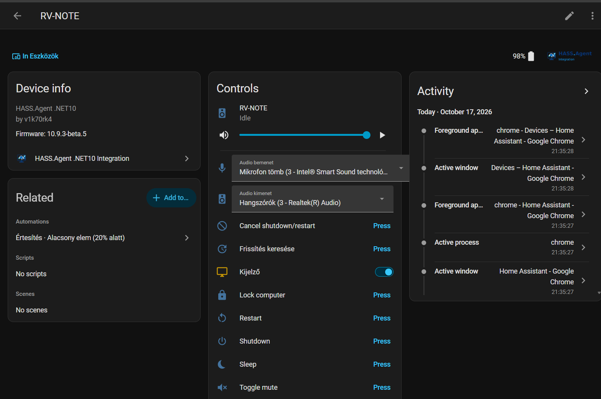
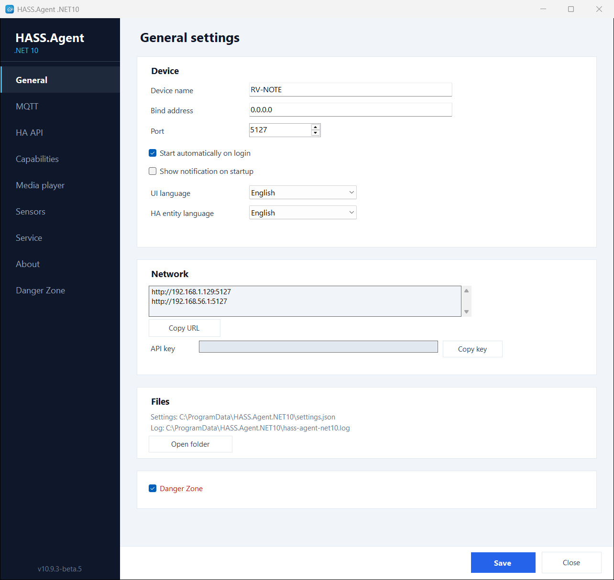

# HASS.Agent .NET10


[](https://www.bestpractices.dev/projects/15316)
[](https://scorecard.dev/viewer/?uri=github.com/v1k70rk4/HASS.Agent.NET10)
[](https://hass-agent.com/)
[](https://ko-fi.com/v1k70rk4)


A modern Windows companion app for Home Assistant.

🌐 **[Website & screenshots](https://hass-agent.com/)**

> ⭐ **Enjoying HASS.Agent?** Please star this repo — and the [Home Assistant integration](https://github.com/v1k70rk4/HASS.Agent.NET10-Integration) too. It helps others find the project and keeps it going!
>
> ☕ If HASS.Agent saved you an evening of tinkering, you can [buy me a coffee on Ko-fi](https://ko-fi.com/v1k70rk4). Everything stays free — it just helps cover things like the code signing certificate.

**HASS.Agent .NET10** began as a fork of the classic [HASS.Agent](https://github.com/LAB02-Research/HASS.Agent) and has grown into a project of its own: a lightweight .NET 10 client built for current Windows desktops. The original client was a .NET 6-era application; this one focuses on a smaller, cleaner runtime, Home Assistant integration via MQTT or WebSocket API, Windows 11-friendly UX, and a split tray app/system service model.

It is designed for Windows PCs you want to observe and control from Home Assistant: media playback, notifications, sensors, shutdown/restart, command buttons, and rich machine state.

The .NET10 line starts at **version 10.0.0**. The classic client is a separate program: if you want to stay with it, it is still available from its own project, and the integration keeps a [`legacy` branch](https://github.com/v1k70rk4/HASS.Agent.NET10-Integration/tree/legacy) for it. Thinking about switching? See [Coming from HASS.Agent](docs/getting-started/migrating.md).

> **Stable:** [10.14.0](https://github.com/v1k70rk4/HASS.Agent.NET10/releases/latest) &nbsp;·&nbsp; [What changed](#what-changed) &nbsp;·&nbsp; [Full changelog](CHANGELOG.md)

---

## Install

### Requirements

- Windows 10 version 2004 / build 19041 or newer
- Windows 11 recommended
- x64 Windows
- Home Assistant with an **MQTT broker** (e.g. Mosquitto) **or the HA API** (WebSocket, no broker, also via Nabu Casa); both carry every feature
- The companion Home Assistant integration:
  [v1k70rk4/HASS.Agent.NET10-Integration](https://github.com/v1k70rk4/HASS.Agent.NET10-Integration) —
  **version 10.6.7 or newer**; the sensors added in 10.7.1 need integration **10.7.0** to appear in
  Home Assistant (the agent and the integration are released with matching version numbers, so keep
  them in step)

Windows versions older than Windows 10 2004 are intentionally blocked. The app targets `net10.0-windows10.0.19041.0` and uses modern Windows APIs for notifications, media sessions, services, sensors, and desktop state.

If you download a published self-contained build, you do **not** need to install the .NET runtime separately. If you want to build from source, install the **.NET 10 SDK**.

### Quick Start

1. Install the Home Assistant integration, [v1k70rk4/HASS.Agent.NET10-Integration](https://github.com/v1k70rk4/HASS.Agent.NET10-Integration). It is in the **Marketplace** (HACS in Home Assistant before 2026.11), so no custom repository is needed: open **Settings → Marketplace**, search for **HASS.Agent** (or use the button), download it and restart Home Assistant.

   [](https://my.home-assistant.io/redirect/hacs_repository/?owner=v1k70rk4&repository=HASS.Agent.NET10-Integration&category=integration)
2. Install the Windows app with winget:

   ```powershell
   winget install v1k70rk4.HASSAgentNET10
   ```

   Or download the signed installer from [Releases](https://github.com/v1k70rk4/HASS.Agent.NET10/releases) (see [Code Signing](#code-signing)), or [build from source](docs/development.md#build-from-source).
3. Run the installer or start `HASS.Agent.NET10.exe` directly.
4. Open the tray icon and go to settings.
5. On the **MQTT** page, enable MQTT and enter your broker address and credentials. Whoever can log in to the broker can send this PC commands, so keep that login to yourself ([more](docs/connection/mqtt.md)).
   Alternatively, on the **HA API** page, enable the WebSocket connection to Home Assistant (useful for remote access via Nabu Casa or when no MQTT broker is available).
6. On the **Capabilities** page, choose which features are handled by the tray app vs. the service.
7. On the **Sensors** page, enable built-in sensors and add custom sensors.
8. Optionally install the Windows service from the **Service** page.
9. On MQTT the PC turns up on its own under **Discovered** in **Settings → Devices & services** of Home Assistant; click **Add** there. Over the HA API the first PC is added by hand, with the button below and then **HA API (WebSocket)**; once the integration has a device, further PCs on the HA API are discovered as well.

   [](https://my.home-assistant.io/redirect/config_flow_start/?domain=hass_agent)

The integration creates the Home Assistant entities from what the agent advertises, so what you switch on or off in the settings appears and disappears there on its own.

### Installer

The setup package is built with [Inno Setup](https://jrsoftware.org/isinfo.php). It is also what winget installs and upgrades (`winget install v1k70rk4.HASSAgentNET10`, `winget upgrade v1k70rk4.HASSAgentNET10`). winget runs it without its wizard pages, showing only the progress, so the options below keep their defaults on a first install (start on login on, the rest off) and their earlier choices on an upgrade; add `--interactive` to go through the wizard. Options during install:

- **Desktop icon** (optional)
- **Start automatically on login** (default: enabled, sets a registry Run key)
- **Install system service** (optional)
- **Clean install** (removes existing settings, API key, and log files — useful for a fresh start)
- **Who may use it** (first install only): *Only me* or *Every user of this PC*, see [Who May Use It on This PC](docs/features/users.md)

The installer automatically configures a **Windows Firewall** rule (Private profile, TCP port 5115) for the Local HTTP API, so manual firewall setup is not needed if you turn that on (it is off by default).

During upgrades the installer stops the running tray app, stops the system service if installed, replaces the files, reinstalls/starts the service, and restarts the tray app. On uninstall the firewall rule is removed automatically, and you are asked whether the settings (with the tokens and passwords in them) should go too.

---

## Features

| | What it does | Details |
|---|---|---|
| <a id="notifications"></a>**Notifications** | Home Assistant notifications as Windows notifications or in the app's own always-visible window, with pictures, buttons and text fields; what is pressed and typed comes back to Home Assistant as an event. | [Notifications](docs/features/notifications.md) |
| <a id="media-player"></a>**Media player** | The active Windows media session as a `media_player`: title, play / pause, skip, seek, volume, cover art, TTS and announcements; its own page in the app. | [Media Player](docs/features/media-player.md) |
| <a id="sendspin"></a>**Sendspin player** | The PC as a player of Music Assistant, in sync with the other players of its group; off until turned on, on the Media player page. | [Sendspin player](docs/features/media-player.md#sendspin-player-music-assistant) |
| <a id="sensors"></a><a id="built-in-sensors"></a>**Sensors** | Built-in system sensors (CPU, memory, drives, network, battery, session, GPU, camera and microphone in use, and more), each with its own polling profile. | [Sensors](docs/sensors/index.md) |
| <a id="custom-sensors"></a>**Custom sensors** | Your own: a process, a service, a drive, an attribute of a built-in sensor, the output of a command or script, a LibreHardwareMonitor value. | [Custom Sensors](docs/sensors/custom.md) |
| <a id="system-commands"></a>**System commands** | Lock, sleep, monitor off, volume, shutdown, restart as buttons and a service call; Hibernate and Log off (off by default). | [System Commands](docs/commands/index.md) |
| <a id="custom-commands"></a>**Custom commands** | Your own buttons: programs, PowerShell scripts, key presses, links, popup windows. | [Custom Commands](docs/commands/custom.md) |
| **Screenshot** | A picture of the screen when Home Assistant asks for one, as an image entity. Off until you turn it on at the PC. | [Screenshot](docs/commands/screenshot.md) |
| **Dashboard popup** | A Home Assistant dashboard, or any web page, in a small window above the tray. | [Dashboard Popup](docs/features/dashboard-popup.md) |
| **Display and audio** | The screen as a light in Home Assistant, the default audio device as a select, the volume of a single app. | [Display and Audio](docs/features/display-and-audio.md) |
| **Hotkeys** | A named key combination becomes an event in Home Assistant, to start automations from the keyboard. | [Hotkeys](docs/features/hotkeys.md) |
| <a id="windows-service"></a>**Windows service** | The same program as a system service, for what should work with nobody logged in. | [Windows Service](docs/features/windows-service.md) |
| <a id="updating-from-home-assistant"></a>**Updates from Home Assistant** | An update entity with a working Install button; silent when the service is installed; only installers signed by the publisher are run; a proxy of its own when GitHub needs one. | [Updating](docs/features/updates.md) |
| **Who may use it** | The settings, with the Home Assistant token and the commands, for every user of the PC or only for the ones you tick. | [Who May Use It](docs/features/users.md) |
| **Kiosk mode** | The tray app runs for the users of a kiosk PC, who cannot open, change or close it; it comes back when it is closed. | [Kiosk Mode](docs/features/kiosk.md) |
| <a id="danger-zone"></a>**Danger Zone** | Opt-in toolbox: MQTT cleanup, live monitor, debug log, factory reset, fast sensors. | [Danger Zone](docs/features/danger-zone.md) |
| <a id="connection-modes"></a><a id="home-assistant-integration"></a>**Connection** | MQTT, the Home Assistant WebSocket API, or both with automatic failover; a notification-only local HTTP API as a fallback. | [Connection Modes](docs/connection/index.md) |

<p align="center"></p>

<p align="center"></p>

## Documentation

The full documentation is the website, **[hass-agent.com](https://hass-agent.com/)**, built from the pages under [`docs/`](docs/):

- [Get started](docs/getting-started/index.md): install, the installer and winget, security and privacy, [coming from HASS.Agent](docs/getting-started/migrating.md)
- [Features](docs/features/index.md): notifications, media player, dashboard popup, display and audio, hotkeys, Windows service, updates, who may use it, kiosk mode, Danger Zone
- [Commands](docs/commands/index.md): system commands and [custom commands](docs/commands/custom.md), with the key names
- [Sensors](docs/sensors/index.md): the built-in sensors, their [attributes](docs/sensors/attributes.md) and [polling profiles](docs/sensors/profiles.md), [custom sensors](docs/sensors/custom.md)
- <a id="mqtt-topics"></a><a id="ha-api-websocket-events"></a><a id="local-http-api"></a><a id="windows-firewall"></a>[Connection](docs/connection/index.md): connection modes, [MQTT](docs/connection/mqtt.md), [HA API](docs/connection/ha-api.md), the [local HTTP API](docs/connection/local-api.md) and the firewall rule
- <a id="build-from-source"></a><a id="minimal-development-setup"></a>[Building and development](docs/development.md): build from source, tests, GitHub Actions, the website
- [Contributing](CONTRIBUTING.md): reporting bugs, sending pull requests
- [Changelog](CHANGELOG.md): every release
- [Home Assistant integration](https://github.com/v1k70rk4/HASS.Agent.NET10-Integration): entities, services, events

---

## Code Signing

Starting with 10.6.8, the release assets (`HASS.Agent.NET10-Setup-<version>.exe`, its uninstaller, and `HASS.Agent.NET10.exe` in the zip) are signed with a Certum *Open Source* code signing certificate:

| | |
|---|---|
| Issued to | `Open Source Developer Viktor Révész` |
| Issued by | `Certum Code Signing 2021 CA` |
| SHA-1 thumbprint | `0C09522639318AF1069507568599DFC5B7F86EE4` |
| Timestamp | `time.certum.pl` (the signature stays valid after the certificate expires) |

To check a download, open its **Properties → Digital Signatures** tab, or from the Windows SDK:

```powershell
signtool verify /pa /v HASS.Agent.NET10-Setup-10.6.8.exe
```

Signing happens on the maintainer's machine through SimplySign, unlocked with a one-time code from the SimplySign app; the private key lives in Certum's cloud HSM and is never exported. The GitHub Actions build itself is unsigned — the signed files replace its assets on the release. A certificate this new has no SmartScreen reputation yet, so Windows may still show a *"Windows protected your PC"* prompt for a while; the publisher name on that prompt is what confirms the file is genuine.

From 10.9.0 on, every release also carries a [Sigstore](https://www.sigstore.dev/) signature per asset (`<asset>.sigstore.json`). A workflow of this repository makes it once the release is out: it checks that the file carries the Certum signature above, then signs it with the workflow's GitHub identity, without any key to keep. It shows that the file is the one this repository published, and it can be checked on any system with [cosign](https://docs.sigstore.dev/cosign/system_config/installation/):

```bash
cosign verify-blob HASS.Agent.NET10-Setup-<version>.exe \
  --bundle HASS.Agent.NET10-Setup-<version>.exe.sigstore.json \
  --certificate-oidc-issuer https://token.actions.githubusercontent.com \
  --certificate-identity-regexp '^https://github\.com/v1k70rk4/HASS\.Agent\.NET10/\.github/workflows/sign-release\.yml@refs/(tags/v<version>|heads/main)$'
```

The last line names the workflow and where it ran: on the release's own tag, or on `main` when it was started by hand for that tag. It runs nowhere else.

## Privacy Policy

This program will not transfer any information to other networked systems unless specifically requested by the user or the person installing or operating it.

HASS.Agent .NET10 communicates only with:

- the **Home Assistant instance and/or MQTT broker configured by the user**, to provide its core functionality,
- the **GitHub API** (`api.github.com` / `github.com`), to check for application updates and download release assets.

No telemetry, analytics, or usage data is collected or transmitted.

---

## What Changed

### 10.14.0

The everyday settings out of the Danger Zone, a proxy for the updates, an About page with the update settings in dialogs of their own, and settings saves that keep what another user's app changed. With them update errors that say why, media covers over MQTT with a broker that sets no packet limit, the app in Italian, and a log that says which part of the app wrote each line. Built on .NET 10.0.15, as 10.13.1. Works with the Home Assistant integration **10.6.7** or newer; the integration **10.14.0** is out at the same time. Signed release.

**Settings and the About page**

- **The everyday settings are out of the Danger Zone.** They are where you would look for them, and no longer need the Danger Zone switched on: backup and restore (export, import, import from HASS.Agent) on the General page; Users of this PC and Kiosk mode on the Service page; the beta channel and *Updates only at this PC* on the About page. The Danger Zone keeps its tools: MQTT maintenance, republishing the discovery, the debug log, the live MQTT monitor, factory reset and fast sensors. See [Danger Zone](docs/features/danger-zone.md).
- **The About page, tidied up.** A **Website** button opens [hass-agent.com](https://hass-agent.com/). Below it an **Updates** box laid out like the Service page: **Check updates**, **Update settings...** (the beta channel, updates only at this PC) and **Proxy settings...**, the last with the proxy in use next to it. Each dialog saves with its own Save button. While a check or a download runs, the two settings buttons wait.
- **Two users' apps no longer undo each other's settings.** Every user's app of a PC, and the service, share one settings file, and each wrote it whole: a save put back the old value of whatever another one had changed meanwhile. A save now writes only what was changed in it, over the file as it is, and the apps take turns saving. A save that cannot replace the settings file keeps what was in it, so a write cut short loses nothing.

**Updates**

- **A proxy for the updates.** The update checks and downloads (GitHub, the only place on the internet the app talks to) go through the proxy Windows is set to, as before, or through one set under **About → Proxy settings**: `http://`, `https://` or `socks5://`, for a proxy app such as Clash or v2rayN that is not set as Windows' proxy. A proxy that asks for a login gets the user name and password typed in there, kept like the MQTT password and left out of a settings export. **Test** tries what is filled in before it is saved. Home Assistant and everything else on the home network never go through it, and an installer still runs only with the publisher's signature. Asked for in [#205](https://github.com/v1k70rk4/HASS.Agent.NET10/issues/205). See [A proxy for the updates](docs/features/updates.md#a-proxy-for-the-updates).
- **Update errors say why.** A failed update check, download or install said only "The SSL connection could not be established" or "An error occurred while establishing a connection to the proxy tunnel". The reason under it comes too now, such as a certificate the proxy showed that is not trusted, or a SOCKS proxy that refused the login: on the About page, in the proxy dialog's Test, in the log and in Home Assistant.
- **Home Assistant follows a change of channel or proxy at once.** Saved in the dialogs, the update entity is checked anew and sent. An answer checked with the old channel or proxy never goes out for the new one, and an earlier check's answer never replaces a later one's.

**Fixed**

- **Fixed: media covers and screenshots were dropped over MQTT when the broker sets no packet limit.** A broker that sends no Maximum Packet Size came through as a limit of 0, so every cover was "over the 0 KB limit" and the media player in Home Assistant had no picture; a screenshot asked for over MQTT was dropped too. No limit now means the app's own 512 KB. When the broker does set a limit, the log says so at connect, and a cover too large for it says so too. Reported in [#221](https://github.com/v1k70rk4/HASS.Agent.NET10/issues/221) by @RockJesus, thank you!

**The log**

- **The log says which part of the app wrote each line.** The tray app, the service and the setup steps write one file, so the same warning from the tray app and the service looked like one line written twice. Each line now has `[tray]`, `[service]` or `[setup]` after its level. A system command says how it came from Home Assistant, as `Executing system command: shutdown (from Home Assistant over MQTT)`. A connection from Music Assistant that a sleep dropped is no longer an error with its whole stack trace: like the other connections that closed, it is one warning line, and only when Music Assistant does not connect again.

**Translations and documentation**

- **Italian**, by @lollox80 in [#225](https://github.com/v1k70rk4/HASS.Agent.NET10/pull/225), thank you! It is on the General page, for the app and for the names of the entities in Home Assistant.
- **Simplified Chinese**: the texts of 10.13.1 in [#214](https://github.com/v1k70rk4/HASS.Agent.NET10/pull/214), then the whole translation gone over again in [#224](https://github.com/v1k70rk4/HASS.Agent.NET10/pull/224) and [#227](https://github.com/v1k70rk4/HASS.Agent.NET10/pull/227), with the Chinese page of the website, all by @natsu-tsuki, thank you!
- **The documentation has a website of its own**, [hass-agent.com](https://hass-agent.com/), with a short page in Hungarian, German, Russian and Simplified Chinese. Thank you to @natsu-tsuki for going over the Chinese one in [#213](https://github.com/v1k70rk4/HASS.Agent.NET10/pull/213).
- **The documentation says a double click on the tray icon opens the settings.** It said a click; a single click opens the dashboard popup, and only with **A click on the tray icon opens it** ticked on the Capabilities page.

<details>
<summary><b>10.13.1</b></summary>

A screenshot of the PC when Home Assistant asks for one, popup windows that keep their page and close by themselves or from Home Assistant, a sensor for the print queues, and a switch for PCs where an update has to be approved at the PC itself. With them a quieter log after a wake, the audio code on NAudio 3, the translations that were missing, and fixes. Built on .NET 10.0.15, as 10.13.0. Works with the Home Assistant integration **10.6.7** or newer; the screenshot, the Print jobs sensor and the update entity without its Install button need the integration **10.13.1**, out at the same time. Signed release.

**New**

- **A screenshot when Home Assistant asks for one.** A new command, **Take a screenshot**, on the Capabilities page under System commands, off until it is ticked at the PC. Ticked, the PC's device in Home Assistant gets a button and an image entity; a press of the button makes the PC take a picture of its screen (every monitor, no wider than 1920 pixels, at most 512 KB) and send it. The PC never takes one on its own: a picture at regular times is an automation that presses the button. The picture is not kept on the broker, over the HA API it does not go on Home Assistant's event bus, and with the MQTT debug switch on it is left out of the packet file. See [Screenshot](docs/commands/screenshot.md).
- **A Print jobs sensor.** Off by default. Its value is the number of jobs that wait in the print queues of the PC, on whichever printer. A job stays in its queue while the printer is switched off, so an automation can switch the printer's plug on when the number leaves 0. The attributes have every printer with its own number of jobs, its state in one word and every state flag Windows keeps for it (`paper_out`, `toner_low`, `offline` and the rest), the default printer, and the first 20 jobs. On a PC with more than 64 printers the number and the attributes cover 64 of them, the default printer among them, and `printer_count` says how many there are in all. The printers are those of the user who is logged in, the ones connected from a print server too, whether the tray app or the service reads the sensor; with nobody logged in the service reports the printers installed on the PC. Asked for in [#191](https://github.com/v1k70rk4/HASS.Agent.NET10/issues/191). Needs the integration 10.13.1. See [Built-in sensors](docs/sensors/index.md).
- **Updates only at this PC.** A new tick on the Danger Zone page, off by default, for a PC where a change of software has to be approved at the PC itself. With it ticked, an install asked for from Home Assistant is refused before anything is downloaded: on MQTT and on the HA API, by the tray app and by the service. Home Assistant gets a notification saying so, and with the integration 10.13.1 the update entity shows the new version without an Install button. Update checks, the notice in the tray and the About page work as before. With several users logged in, a tick made in one user's window holds at once in the other's app as well. Most PCs are better off without it: an update is how the built-in .NET runtime gets its security fixes, and what Home Assistant can ask for is narrow as it is (the PC fetches the installer itself, runs it only with the publisher's signature, and never goes back a version). Asked for in [#199](https://github.com/v1k70rk4/HASS.Agent.NET10/issues/199). See [Updates only at the PC](docs/features/updates.md#updates-only-at-the-pc).

**Popup windows**

- **The dashboard popup can keep its page loaded.** A new tick on the Capabilities page, *Keep the page loaded in the background*, off by default. With it the popup is hidden, not closed, when you click elsewhere, and the next click on the tray icon shows the page at once, as you left it. The page then keeps the memory of a browser tab for as long as the app runs. Asked for in [#190](https://github.com/v1k70rk4/HASS.Agent.NET10/issues/190). See [Dashboard popup](docs/features/dashboard-popup.md).
- **Popup window commands: fields for the window, and one window per command.** The editor has fields for the size, **Popup above the tray** (a window like the dashboard popup), **Keep the page loaded** and **Closes after** so many seconds. A command has one window now: pressed again, it is replaced with a fresh page, or, when it keeps its page, brought back as it was. Before, every press opened one more window. See [Custom commands](docs/commands/custom.md#popup-windows).
- **A new custom command type, Close popup windows.** It closes the window of the Popup window command it names, or all of them and the dashboard popup for `*`. In Home Assistant it is a button like any other custom command.
- **A window opened from Home Assistant comes over the other windows.** It used to open behind the program in front. It leaves the keyboard with the program you are typing into.

**Coming from the classic HASS.Agent**

- **The classic HASS.Agent's tray icon web view comes over.** Taking over the classic client's settings now brings its tray icon web view as the dashboard popup, with its page, its size and whether it loads in the background, and its Tray WebView command as a Popup window command above the tray. A WebView command whose window was smaller than 200 or bigger than 4000 pixels on a side gets the nearest size this app takes; it used to come over with a size that never opened. See [Coming from HASS.Agent](docs/getting-started/migrating.md).
- **The classic HASS.Agent's printer sensors come over** to the Print jobs sensor when the classic client's settings are taken over.

**A quieter log after a wake**

- **A quieter log after a wake: the Sendspin player.** When the PC wakes, Music Assistant tries several connections to the player at once and one gets through; each of the others left a warning, dozens a day on a laptop. They are held back now: a debug line when a connection follows, one warning with their number when none does within two minutes. The same goes for the player's own connection, closed by the sleep, when the player is the one that dials the server. The clock sync's "convergence lost" after a wake is a debug note; the clock finds its way back by itself.
- **A quieter log after a wake: MQTT.** One loss of a connection that had lived, as after a sleep or a restart of the broker, is an info line now; the app is back five seconds later. A connection that dies within 30 seconds of connecting is still a warning, and so is a reconnect that fails.

**Fixed**

- **Fixed: the tray app did not come back after an install asked for from Home Assistant, when the download took long.** The app hands the install to the service and leaves a watchdog behind that starts it again once the setup has run. The watchdog waited half a minute for the setup to start, but the service first downloads the installer: on a download of 34 seconds it gave up, and the PC was left without its tray app until the next sign-in. It waits fifteen minutes now.
- **Fixed: turning MQTT off left the PC on the broker.** The retained messages stayed there, so the broker went on saying the PC is online, with its version and update state of that day, and a Home Assistant started later found it by them. The tray app and the service now take what they keep there off the broker when MQTT is turned off; turned on again, it all comes back with the next connection.
- **Fixed: many printers that do not answer held up the rest of the app.** The Print jobs sensor asks every printer at the same time; with more of them hanging than the app had threads ready, as with a print server that is not reachable, the connection to Home Assistant and the commands waited behind the questions. Each question has a thread of its own now, at most 64 are out at once, and of more than 64 printers 64 are asked and listed, the default among them.
- **Fixed: "Unable to publish media state" in the log now and then.** A media session whose app was just closing failed that round's update of the media player. When an update does fail, the log now also says what kind of failure it was and where it came from.
- **Fixed: a custom command with two spaces before its arguments was refused.** `C:\Tools\app.exe  /x` was taken for a path with a space in it, which 10.13.0 does not run without quotes.
- **Fixed: a settings folder made by an elevated command stayed the administrators' alone.** Where there was no settings folder yet (the app used from its zip, or the folder deleted) and `--install-service`, `--kiosk` or an approval made it, the app then started for nobody who was not elevated. Such a folder is now open to every user, as a silent first install leaves it, and the app asks who it is for. A folder that 10.13.0 left that way is opened by the next elevated command or update.
- **Fixed: on a PC in a domain, an update could put the settings folder aside when the domain could not be asked.** A folder made by a user who is an administrator through a domain group was taken for one made by a user who is no administrator, when Windows could not tell the user's groups (a laptop away from the network). The command now stops and says so, and the folder stays as it is; with the domain in reach it goes through as before.
- **Kiosk mode: the app is not started every minute while it would only stop again.** With a settings folder that is not the PC's, the kiosk task started the app once a minute until an administrator put the folder right.
- **The sensors the + button makes from a sensor's attributes are ticked as the sensor is**, for the tray app, the service or both. They used to be ticked for both wherever both can read the sensor, whatever the sensor itself was ticked for.
- **`--install-service` run without an administrator's rights says so**, and touches nothing; it used to answer that the settings folder could not be made safe.
- **The service's approval prompt writes out every character that is not seen**, as `<U+202E>`: also the ones past the first 65 536, the spaces that are not the plain one, and the blank ones among letters and symbols. Letters written from right to left are shown as they are, with a line below the entry saying that its parts may be shown in another order.
- **`--sendspin-token` run as SYSTEM makes a missing settings folder the way the service does**, with its rule from the first moment.

**Translations and libraries**

- **German, Russian and Chinese: the texts that were still in English** are translated, 95 in German, 74 in Russian and 22 in Chinese, with the words each translation already uses; they are on each file's list for its translator to check.
- **Simplified Chinese for the texts of 10.13.0**, by @natsu-tsuki in [#188](https://github.com/v1k70rk4/HASS.Agent.NET10/pull/188), thank you!
- **The audio code is on NAudio 3.** The Sendspin player's output, and the audio device sensors and selects, were moved to the new major version of the library under them. Nothing to set, and nothing should sound different: say so if the player, the volume or the device selects behave in another way than before.
- **Libraries**: WebView2 1.0.4314.35, MQTTnet 5.2, and the 10.0.15 builds of the two System packages.

</details>

Older versions are in the [changelog](CHANGELOG.md).

---

## Status

This is a project of its own, not the original LAB02 release line, and it is not affiliated with it. It began as a fork of HASS.Agent and has been developed independently since.

The goal is a focused Windows/Home Assistant companion that keeps the useful HASS.Agent ideas, drops legacy weight, and is built around .NET 10, MQTT or the HA API, and a tray app/service split. The classic client stays with its own project; the integration keeps a [`legacy` branch](https://github.com/v1k70rk4/HASS.Agent.NET10-Integration/tree/legacy) for it.

## License

MIT
