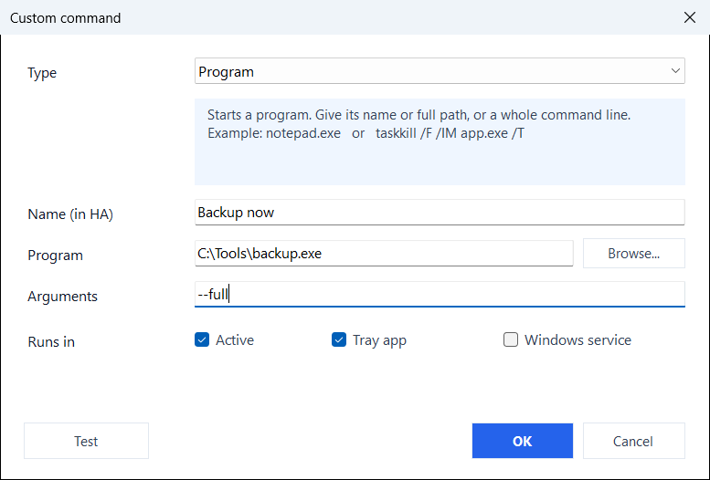

# Custom commands

Beyond the built-in commands, you can define your own on the **Capabilities** page. Each custom command becomes a button in Home Assistant. **Add**, or a double click on a row, opens the editor; its **Test** button runs the command right away, in the tray app. Shift and Ctrl pick several rows, and **Remove** takes them all (10.10.0+).

<figure class="shot" markdown>
{ width="600" }
<figcaption>The command editor</figcaption>
</figure>

| Type | `Command / script` field | `Arguments` field |
|------|--------------------------|-------------------|
| **Program** | Executable path or name (e.g. `notepad.exe`, `C:\Tools\backup.exe`), or a full command line (e.g. `taskkill /F /IM app.exe /T`) | Command-line arguments (optional; can also be put inline in the command field) |
| **PowerShell** | Inline command, or a `.ps1` path | Script arguments (used only for `.ps1`) |
| **PowerShell 7 (pwsh)** | Same as PowerShell, run with `pwsh.exe` | Same as PowerShell |
| **Key press** | One or more key combinations, separated by spaces or commas (e.g. `win+r`, `ctrl+shift+esc`, `ctrl+c ctrl+v`); the full-width `，`, `、`, space and `＋` of a Chinese or Japanese input method work too | Not used |
| **Open address** | A link to open in the default browser (e.g. `https://example.com`), or an app link such as `ms-settings:display` | Not used |
| **Popup window (WebView)** | A web address (`http://` or `https://`) to show in a window of its own | Window size, e.g. `1024x720` (optional) |

- **Program** commands launch via the shell, so GUI apps show in your session; PowerShell runs hidden with `-NoProfile -ExecutionPolicy Bypass`.
- Tick **Tray**, **Svc**, or both to choose where a command runs. Service-run commands execute in the `SYSTEM` session (no visible UI), and only after an administrator has approved them: [Commands the service runs](../features/windows-service.md#commands-the-service-runs).
- **Key press**, **Open address** and **Popup window** act on the desktop of the logged-in user, so they run in the tray app only; the **Svc** tick is cleared for them on save.
- **Security:** you own the command list. Home Assistant only sends the command's id to trigger it, never the program or script itself, so it cannot run arbitrary code on your PC. Requires the integration 10.6.0 or newer to show the buttons.

## Key names

Letters and digits as they are, plus `ctrl`, `shift`, `alt`, `win`, `enter`, `esc`, `tab`, `space`, `backspace`, `delete`, `insert`, `home`, `end`, `pageup`, `pagedown`, `up`, `down`, `left`, `right`, `f1`-`f24`, `num0`-`num9`, `printscreen`, `pause`, `capslock`, `numlock`, `scrolllock`, `menu`, `plus`, `minus`, `comma`, `period`, `play_pause`, `next_track`, `prev_track`, `media_stop`, `volume_up`, `volume_down`, `volume_mute`, `browser_back`, `browser_forward`, `browser_refresh`, `browser_home`. Keys in a combination are joined with `+`. Windows does not let a normal program send keys to a window that runs as administrator, or to the lock screen.

The same names make a [hotkey](../features/hotkeys.md), the other way round: a combination pressed on the PC that reaches Home Assistant.

## Examples

A camera when the doorbell rings, as a popup window:

```text
Type: Popup window (WebView)
Command: https://homeassistant.local:8123/lovelace/doorbell?kiosk
Arguments: 800x600
```

The doorbell automation then presses the button:

```yaml
actions:
  - action: button.press
    target:
      entity_id: button.my_pc_doorbell_camera
```

A backup script from the service, at night, with nobody logged in:

```text
Type: PowerShell
Command: C:\Tools\backup.ps1
Tray: off, Svc: on
```
