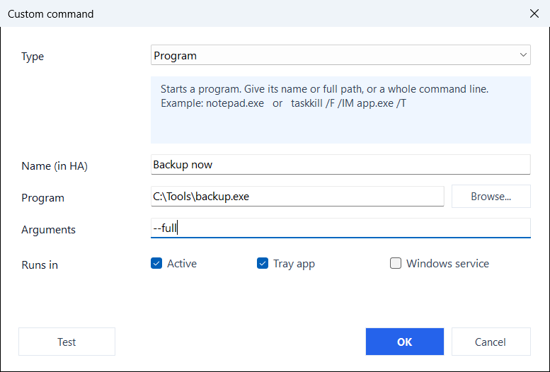

# Custom commands

Beyond the built-in commands, you can define your own on the **Capabilities** page. Each custom command becomes a button in Home Assistant. **Add**, or a double click on a row, opens the editor; its **Test** button runs the command right away, in the tray app. Shift and Ctrl pick several rows, and **Remove** takes them all (10.10.0+).

<figure class="shot" markdown>
{ width="600" }
<figcaption>The command editor</figcaption>
</figure>

| Type | `Command / script` field | `Arguments` field |
|------|--------------------------|-------------------|
| **Program** | Executable path or name (e.g. `notepad.exe`, `C:\Tools\backup.exe`), or a full command line (e.g. `taskkill /F /IM app.exe /T`) | Command-line arguments (optional; can also be put inline in the command field) |
| **PowerShell** | Inline command, or a `.ps1` path | Script arguments (used only for `.ps1`) |
| **PowerShell 7 (pwsh)** | Same as PowerShell, run with `pwsh.exe` | Same as PowerShell |
| **Key press** | One or more key combinations, separated by spaces or commas (e.g. `win+r`, `ctrl+shift+esc`, `ctrl+c ctrl+v`); the full-width `，`, `、`, space and `＋` of a Chinese or Japanese input method work too | Not used |
| **Open address** | A link to open in the default browser (e.g. `https://example.com`), or an app link such as `ms-settings:display` | Not used |
| **Popup window (WebView)** | A web address (`http://` or `https://`) to show in a window of its own | What the window is like, each part optional: a size, `popup`, `keep`, a time to close after, e.g. `1024x720 keep 30s`; see [Popup windows](#popup-windows) |
| **Close popup windows** | The name of a **Popup window** command, to close its window, or `*` for every popup window | Not used |

- **Program** commands launch via the shell, so GUI apps show in your session; PowerShell runs hidden with `-NoProfile -ExecutionPolicy Bypass`.
- Put a program's path in quotes when it has a space in it and arguments follow it: `"C:\Program Files\App\app.exe" /x`. Without the quotes the command is not run, and the editor says so when you save. Cut at the first space, the line would name another program (`C:\Program`).
- Tick **Tray**, **Svc**, or both to choose where a command runs. Service-run commands execute in the `SYSTEM` session (no visible UI), and only after an administrator has approved them: [Commands the service runs](../features/windows-service.md#commands-the-service-runs).
- **Key press**, **Open address**, **Popup window** and **Close popup windows** act on the desktop of the logged-in user, so they run in the tray app only; the **Svc** tick is cleared for them on save.
- **Security:** you own the command list. Home Assistant only sends the command's id to trigger it, never the program or script itself, so it cannot run arbitrary code on your PC. Requires the integration 10.6.0 or newer to show the buttons.

## Popup windows

A **Popup window** command has one window. Pressed again while its window is open, it closes that one and opens a new one with the page loaded afresh, so windows do not pile up and a camera is live every time. Before 10.13.1 every press opened one more window.

A window asked for from Home Assistant comes over the other windows, and leaves the keyboard with the program you are typing into. Before 10.13.1 it opened behind the program in front.

The **Window** field takes up to four things, in any order, each of them optional:

| Part | Example | What it does |
|------|---------|--------------|
| A size | `1024x720` | Width and height, 200 to 4000 each way. `1024x720` when left out. |
| `popup` | `popup` | A window like the [dashboard popup](../features/dashboard-popup.md): no frame, above the tray, over every other window. It goes away at a click elsewhere once you have clicked into it, after its time, or with a Close popup windows command. Without the word it is an ordinary window in the middle of the screen. |
| `keep` | `keep` | The page stays loaded when the window is closed: closing only hides it, and the next press shows it at once and as it was. For a page that takes long to load and has nothing live to restart, such as a player or a dashboard. It keeps the memory of a browser tab until the app exits. |
| A time | `30s`, `5m`, `1h` | The window closes by itself this long after it was shown, from one second to 24 hours. With `keep` it is hidden instead. |

A **Close popup windows** command closes them from Home Assistant, as their own X would. Its field takes the name of the Popup window command whose window is to go, as it stands in the list, or `*` for all of them and the [dashboard popup](../features/dashboard-popup.md). When there is nothing open, nothing happens. Both need 10.13.1 or newer.

Saving the settings tidies up: the window of a command that was removed or switched off is closed, and so is a kept one whose command now has another address or another **Window** field. A command that was renamed is found by its new name.

## Key names

Letters and digits as they are, plus `ctrl`, `shift`, `alt`, `win`, `enter`, `esc`, `tab`, `space`, `backspace`, `delete`, `insert`, `home`, `end`, `pageup`, `pagedown`, `up`, `down`, `left`, `right`, `f1`-`f24`, `num0`-`num9`, `printscreen`, `pause`, `capslock`, `numlock`, `scrolllock`, `menu`, `plus`, `minus`, `comma`, `period`, `play_pause`, `next_track`, `prev_track`, `media_stop`, `volume_up`, `volume_down`, `volume_mute`, `browser_back`, `browser_forward`, `browser_refresh`, `browser_home`. Keys in a combination are joined with `+`. Windows does not let a normal program send keys to a window that runs as administrator, or to the lock screen.

The same names make a [hotkey](../features/hotkeys.md), the other way round: a combination pressed on the PC that reaches Home Assistant.

## Examples

A camera when the doorbell rings, as a popup window:

```text
Type: Popup window (WebView)
Command: https://homeassistant.local:8123/lovelace/doorbell?kiosk
Arguments: 800x600
```

The doorbell automation then presses the button:

```yaml
actions:
  - action: button.press
    target:
      entity_id: button.my_pc_doorbell_camera
```

To have the window go by itself after a minute, write `800x600 60s` as the arguments. To close it when the door is opened, add a second command and press its button from that automation:

```text
Type: Close popup windows
Command: Doorbell camera
```

A backup script from the service, at night, with nobody logged in:

```text
Type: PowerShell
Command: C:\Tools\backup.ps1
Tray: off, Svc: on
```
