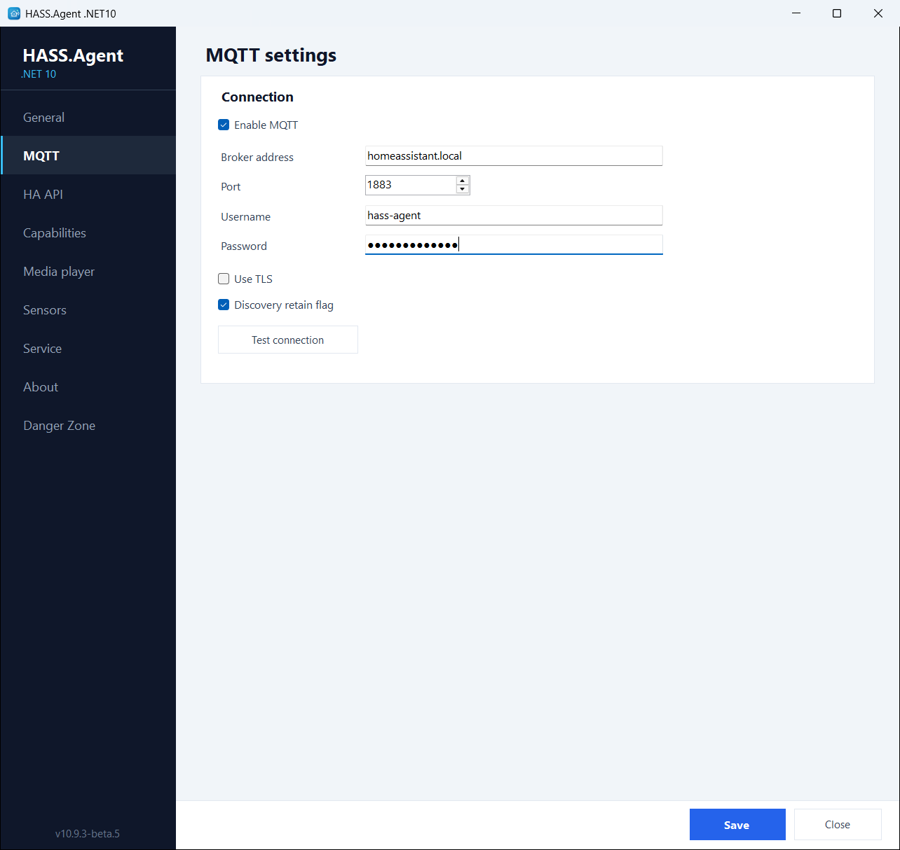
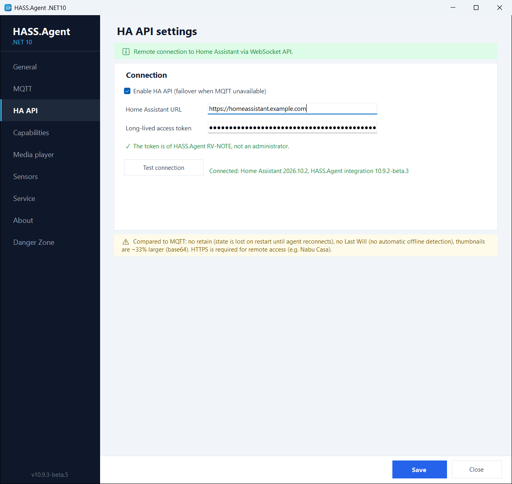

# Connection modes

The Home Assistant side is the companion integration, [v1k70rk4/HASS.Agent.NET10-Integration](https://github.com/v1k70rk4/HASS.Agent.NET10-Integration), installed from the Marketplace (HACS in Home Assistant before 2026.11; [Get started](../getting-started/index.md)). It creates the Home Assistant entities from what the app advertises.

The app supports three connection modes. MQTT and the HA API are equals: either one carries every feature, and which suits a home better is in [Which one?](#which-one) below. They can also be used together: the HA API is then the automatic failover when the MQTT broker is unreachable.

| Feature | MQTT | HA API (WebSocket) | Local HTTP API |
|---------|:----:|:------------------:|:--------------:|
| Notifications | yes | yes | yes |
| Media player | yes | yes | |
| Notification action events | yes | yes | |
| System sensors | yes | yes | |
| Command buttons | yes | yes | |
| Update entity | yes | yes | |
| Auto-discovery | yes | yes | |
| Service integration | yes | yes | |
| Offline detection | yes (Last Will) | yes (heartbeat) | |
| Last values kept through a Home Assistant restart while the PC is off | yes (retained) | | |
| A Home Assistant user of the PC's own, not an administrator | | yes | |
| Remote access (Nabu Casa, your own domain) | | yes | |

**MQTT**. The device is discovered through MQTT discovery and every feature works. It needs a broker on the local network (Mosquitto, for example); if you run Zigbee2MQTT, you already have one. The broker keeps the last values (retained messages), so a PC that is off or asleep while Home Assistant restarts still shows them, and its Last Will takes the PC offline when the connection drops. Encryption is TLS on the broker, which needs a certificate there. Whoever has a broker login that may write the PC's topics can send it commands, so give the PCs logins of their own rather than one shared by everything. [MQTT](mqtt.md) has the topics and the broker advice.

**HA API (WebSocket)**. The app connects straight to Home Assistant's WebSocket API with a long-lived access token: no broker, and it works from away too. Every feature works. The token belongs to [a Home Assistant user of the PC's own](#a-home-assistant-user-for-the-pc), not an administrator, and the integration sends each PC only its own commands. The app sends a heartbeat; without one for 90 seconds Home Assistant shows it offline. What it does not have is a broker's memory: after a Home Assistant restart the values come back when the app has reconnected, which it does on its own, and a PC that is off or asleep meanwhile is unavailable until it is back. Media thumbnails are about a third larger (base64 encoding). [HA API](ha-api.md) has the events.

The HA API needs a certificate as well, once it leaves the home: from away it goes over https, and the certificate has to be one Windows trusts. Nabu Casa gives one, as does your own domain with Let's Encrypt; a self-signed certificate is refused unless its CA is in the Windows certificate store. That is also its strength: with it, the token and everything after it travel encrypted, to a server the PC has checked. At home plain http works too, but the token then crosses the network unencrypted; the page warns about it ([The address](#the-address)).

**Local HTTP API**. A minimal fallback, off by default: turned on on the General page, the app runs a small HTTP server that Home Assistant connects to. Only notifications are supported. Requires manual setup (IP address, port, API key). Use MQTT or the HA API instead for full functionality. [Local HTTP API](local-api.md).

<figure class="shot" markdown>
{ width="700" }
<figcaption>The MQTT page, with the connection test</figcaption>
</figure>

<figure class="shot" markdown>
{ width="700" }
<figcaption>The HA API page: the address, the token and whose it is</figcaption>
</figure>

## Which one?

- **MQTT**, if a broker runs anyway, or the PCs' last values should stay in Home Assistant through a restart while the PCs are off.
- **HA API**, if there is no broker, a laptop leaves home, or each PC should have a Home Assistant user of its own with nothing else to set up.
- **Both**, to have the HA API take over when the broker drops.

## A Home Assistant user for the PC

> From 10.9.1, with the integration 10.9.1 or newer.

The token in the **HA API** settings belongs to a Home Assistant user, and works with that user's rights. Give the PC a user of its own who is **not an administrator**: if the PC is ever broken into, its token then cannot install add-ons, read `secrets`, change users or the configuration. (Any Home Assistant user can still see states and call actions; Home Assistant has no finer permissions than that.)

The **HA API** page shows whose the token is, under the token field.

**The easy way:** connect with your own (administrator's) token as usual. When the app's window opens, it offers to create a user for this PC; the same is the **Create a user for this PC** button next to the line under the token. The integration makes a Home Assistant user named *HASS.Agent* and the PC's name, who is not an administrator and has no password (nobody can log in with it), gives it a token, and the app switches to it. Your administrator token stays in Home Assistant: delete it in your profile (**Security**) if nothing else uses it. Deleting the PC's user later cuts the PC off until it gets a token again.

**By hand**, if you would rather not put an administrator's token on the PC even once:

1. In Home Assistant, **Settings → People → Add person**: a name such as *hass-agent-office-pc*, **Allow login** on, **Administrator** off.
2. Log in as that user once, open its profile, **Security** tab, and create a **long-lived access token** at the bottom.
3. Put the token in the **HA API** page of the app.

Home Assistant then asks an administrator once: a new PC shows up under **Settings → Devices & services → Discovered**; a PC already set up that now uses another user asks for that user to be allowed. Until then the PC's messages are refused, and the log says why. An administrator's token keeps working as before, without the question.

The very first PC of a Home Assistant that has no HASS.Agent device yet: add it with **Add integration → HASS.Agent → HA API (WebSocket)** and keep that dialog open while the app connects.

## The address

A Home Assistant address typed without `http://` or `https://` gets https unless it points into the home network: a `.local` name, a name without a dot, a private IP address and `localhost` get http, as Home Assistant answers there by default. An address on the internet (a Nabu Casa one, your own domain) therefore never sends the token unencrypted by accident. The page warns when the address is plain http.
