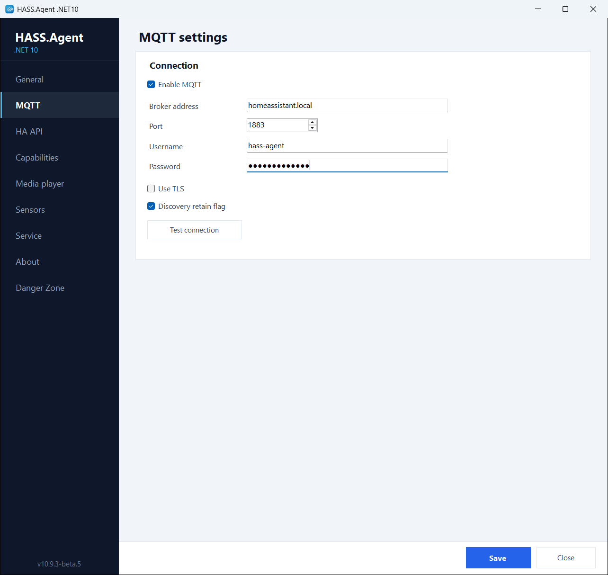
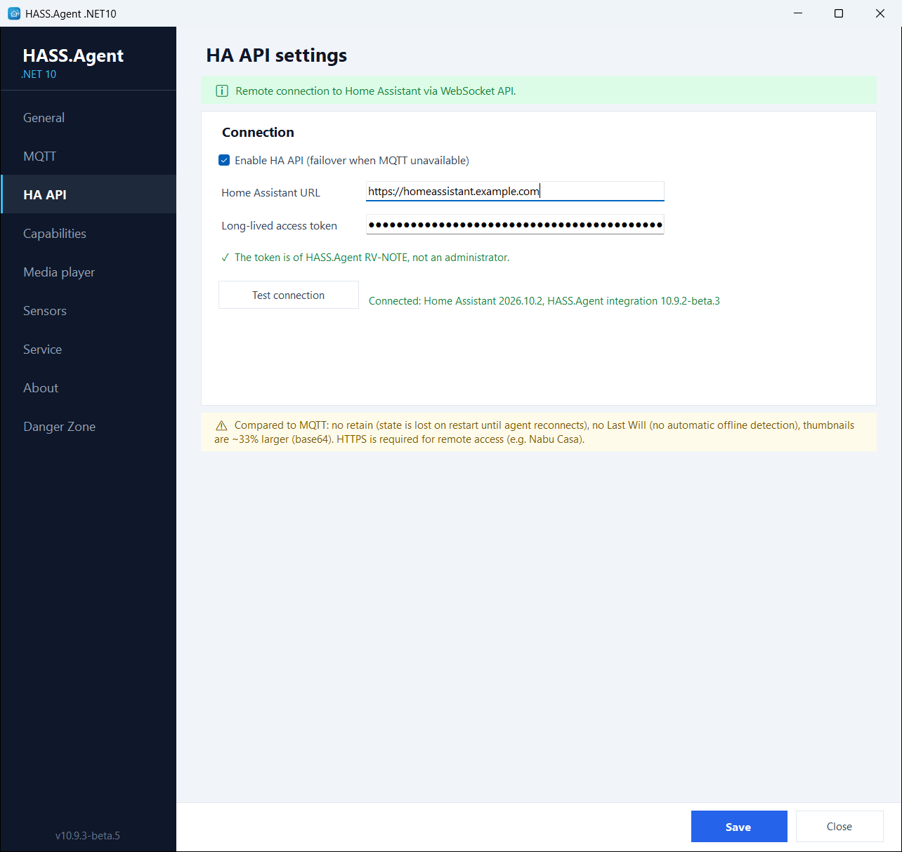

# Connection modes

The Home Assistant side is the companion integration, [v1k70rk4/HASS.Agent.NET10-Integration](https://github.com/v1k70rk4/HASS.Agent.NET10-Integration), installed from the Marketplace (HACS in Home Assistant before 2026.11; [Get started](../getting-started/index.md)). It creates the Home Assistant entities from what the app advertises.

The app supports three connection modes. MQTT and the HA API can be used together: the HA API is then the automatic failover when the MQTT broker is unreachable.

| Feature | MQTT | HA API (WebSocket) | Local HTTP API |
|---------|:----:|:------------------:|:--------------:|
| Notifications | yes | yes | yes |
| Media player | yes | yes | |
| Notification action events | yes | yes | |
| System sensors | yes | yes | |
| Command buttons | yes | yes | |
| Update entity | yes | yes | |
| Auto-discovery | yes | yes | |
| Service integration | yes | yes | |
| Retained state on restart | yes | | |
| Last Will (offline detection) | yes | | |
| Remote access (Nabu Casa) | | yes | |

**MQTT** (recommended). The device is discovered automatically through MQTT discovery. All features work. Requires an MQTT broker on the local network (Mosquitto, for example); if you use Zigbee2MQTT, you already have one. [MQTT](mqtt.md) has the topics and the broker advice.

**HA API (WebSocket)**. The app connects directly to Home Assistant's WebSocket API with a long-lived access token. Works remotely (through Nabu Casa, for example) without an MQTT broker. Almost all features work, with some trade-offs: no retained state (sensor values are lost until the app reconnects after a restart), no MQTT Last Will (no automatic offline detection), and media thumbnails are about a third larger (base64 encoding). HTTPS is required for remote access. [HA API](ha-api.md) has the events.

**Local HTTP API**. A minimal fallback, off by default: turned on on the General page, the app runs a small HTTP server that Home Assistant connects to. Only notifications are supported. Requires manual setup (IP address, port, API key). Use MQTT or the HA API instead for full functionality. [Local HTTP API](local-api.md).

<figure class="shot" markdown>
{ width="700" }
<figcaption>The MQTT page, with the connection test</figcaption>
</figure>

<figure class="shot" markdown>
{ width="700" }
<figcaption>The HA API page: the address, the token and whose it is</figcaption>
</figure>

## A Home Assistant user for the PC

> From 10.9.1, with the integration 10.9.1 or newer.

The token in the **HA API** settings belongs to a Home Assistant user, and works with that user's rights. Give the PC a user of its own who is **not an administrator**: if the PC is ever broken into, its token then cannot install add-ons, read `secrets`, change users or the configuration. (Any Home Assistant user can still see states and call actions; Home Assistant has no finer permissions than that.)

The **HA API** page shows whose the token is, under the token field.

**The easy way:** connect with your own (administrator's) token as usual. When the app's window opens, it offers to create a user for this PC; the same is the **Create a user for this PC** button next to the line under the token. The integration makes a Home Assistant user named *HASS.Agent* and the PC's name, who is not an administrator and has no password (nobody can log in with it), gives it a token, and the app switches to it. Your administrator token stays in Home Assistant: delete it in your profile (**Security**) if nothing else uses it. Deleting the PC's user later cuts the PC off until it gets a token again.

**By hand**, if you would rather not put an administrator's token on the PC even once:

1. In Home Assistant, **Settings → People → Add person**: a name such as *hass-agent-office-pc*, **Allow login** on, **Administrator** off.
2. Log in as that user once, open its profile, **Security** tab, and create a **long-lived access token** at the bottom.
3. Put the token in the **HA API** page of the app.

Home Assistant then asks an administrator once: a new PC shows up under **Settings → Devices & services → Discovered**; a PC already set up that now uses another user asks for that user to be allowed. Until then the PC's messages are refused, and the log says why. An administrator's token keeps working as before, without the question.

The very first PC of a Home Assistant that has no HASS.Agent device yet: add it with **Add integration → HASS.Agent → HA API (WebSocket)** and keep that dialog open while the app connects.

## The address

A Home Assistant address typed without `http://` or `https://` gets https unless it points into the home network: a `.local` name, a name without a dot, a private IP address and `localhost` get http, as Home Assistant answers there by default. An address on the internet (a Nabu Casa one, your own domain) therefore never sends the token unencrypted by accident. The page warns when the address is plain http.
