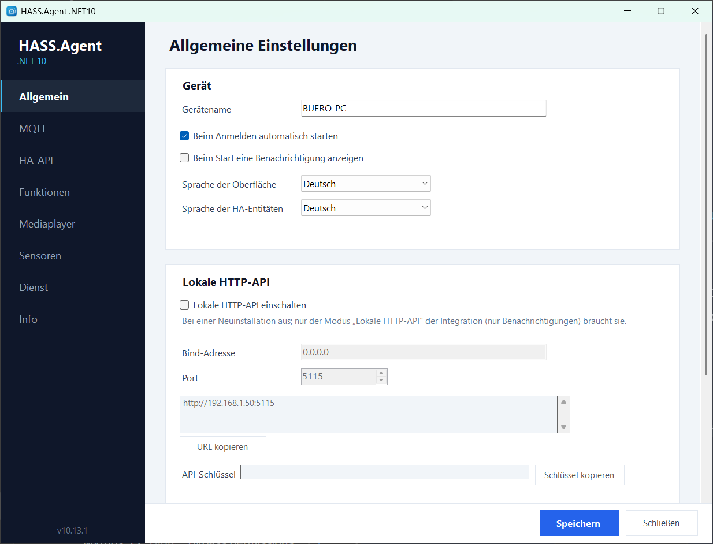

<div class="hero" markdown>

{ .logo }

<p class="eyebrow">.NET 10 · WINDOWS 10 / 11 · AUCH AUF DEUTSCH</p>

# HASS.Agent .NET10

<p class="tag">Ein moderner, schlanker Windows-Begleiter für Home Assistant: Benachrichtigungen, Mediensteuerung, Sensoren, Befehle und Updates mit einem Klick.</p>

[:material-download: Herunterladen](https://github.com/v1k70rk4/HASS.Agent.NET10/releases/latest){ .md-button .md-button--primary }
[:material-rocket-launch: Erste Schritte (englisch)](../getting-started/index.md){ .md-button }
[:material-github: GitHub](https://github.com/v1k70rk4/HASS.Agent.NET10){ .md-button }

oder `winget install v1k70rk4.HASSAgentNET10`

</div>

## Was kann es?

Du siehst und steuerst deine Windows-PCs in Home Assistant. Die App läuft im Infobereich; dazu lässt sich ein Systemdienst installieren, für alles, was auch ohne angemeldeten Benutzer funktionieren soll.

<div class="grid cards" markdown>

-   :material-bell-ring:{ .lg .middle } **Benachrichtigungen**

    ---

    Benachrichtigungen aus Home Assistant als Windows-Benachrichtigung oder in einem eigenen, immer sichtbaren Fenster der App: mit Bildern, Schaltflächen und Textantworten, die zu Home Assistant zurückkommen.

-   :material-music:{ .lg .middle } **Mediaplayer**

    ---

    Was auf dem PC läuft, ist auch in Home Assistant da: Wiedergabe, Pause, Titelsprung, Lautstärke, Cover. TTS-Durchsagen sind auch auf einem stummgeschalteten PC zu hören.

-   :material-chart-line:{ .lg .middle } **Sensoren**

    ---

    Eingebaute Systemsensoren und deine eigenen: ein Prozess, ein Dienst, ein Laufwerk, die Ausgabe eines Skripts, ein Wert aus LibreHardwareMonitor.

-   :material-lightning-bolt:{ .lg .middle } **Befehle**

    ---

    Sperren, Energie sparen, Herunterfahren, Neustart, und eigene Schaltflächen: Programme, PowerShell-Skripte, Tastendrücke, Links. Aus Automatisierungen oder vom Dashboard.

-   :material-dock-window:{ .lg .middle } **Dashboard**

    ---

    Dein Home-Assistant-Dashboard in einem kleinen Fenster über dem Infobereich, einen Klick entfernt. Oder jede beliebige Seite in einem eigenen Fenster, etwa das Kamerabild, wenn es klingelt.

-   :material-keyboard:{ .lg .middle } **Tastenkürzel**

    ---

    Eine Tastenkombination bekommt einen Namen und wird zu einem Ereignis in Home Assistant: So startest du jede Automatisierung von der Tastatur aus.

-   :material-update:{ .lg .middle } **Updates aus Home Assistant**

    ---

    Die Update-Entität hat eine echte Schaltfläche **Installieren**. Mit dem Systemdienst läuft das Update still im Hintergrund, und es wird nur ein Installer ausgeführt, der die Signatur des Herausgebers trägt.

-   :material-shield-check:{ .lg .middle } **Sicherheit**

    ---

    Der PC braucht kein Administrator-Token: Er arbeitet mit einem eigenen Home-Assistant-Benutzer ohne Administratorrechte. Jede Version ist signiert, die App enthält keine Telemetrie.

</div>

## Spricht Deutsch

Die Oberfläche der App ist auf Deutsch: Auf einem deutschen Windows startet sie von selbst so, sonst lässt sich die Sprache auf der Seite **Allgemein** unter **Sprache der Oberfläche** wählen. Die Namen der Entitäten in Home Assistant werden unabhängig davon eingestellt (**Sprache der HA-Entitäten**).

<figure class="shot" markdown>
{ width="700" }
<figcaption>Die Seite „Allgemein“ auf Deutsch</figcaption>
</figure>

## Installation in drei Schritten

Du brauchst Windows 11 oder Windows 10 (Version 2004 oder neuer, x64), Home Assistant 2026.6 oder neuer und einen MQTT-Broker **oder** die WebSocket-API von Home Assistant. Für die API ist kein Broker nötig, und sie funktioniert auch von unterwegs, zum Beispiel über Nabu Casa.

1. **Die Integration.** Öffne in Home Assistant unter **Einstellungen** den **Marketplace** (in Home Assistant vor 2026.11 ist das HACS), suche die Integration **HASS.Agent**, lade sie herunter und starte Home Assistant neu.

    [](https://my.home-assistant.io/redirect/hacs_repository/?owner=v1k70rk4&repository=HASS.Agent.NET10-Integration&category=integration)

2. **Die Windows-App.** Installiere sie mit winget, oder lade den signierten Installer von der [Release-Seite](https://github.com/v1k70rk4/HASS.Agent.NET10/releases/latest) herunter:

    ```powershell
    winget install v1k70rk4.HASSAgentNET10
    ```

    Die App wohnt im Infobereich: Ein Doppelklick auf ihr Symbol öffnet die Einstellungen.

3. **Die Verbindung.** Trage auf der Seite **MQTT** die Adresse des Brokers und eine Anmeldung ein, oder auf der Seite **HA-API** die Adresse von Home Assistant und ein langlebiges Zugriffstoken. Über MQTT erscheint der PC von selbst in Home Assistant unter **Geräte & Dienste**, bei den entdeckten Geräten. Über die HA-API wird der erste PC durch Hinzufügen der Integration aufgenommen (**HASS.Agent → HA API (WebSocket)**), alle weiteren findet Home Assistant selbst.

## Wie geht es weiter?

Die ausführliche Dokumentation ist auf Englisch:

- [Get started](../getting-started/index.md): die Installation Schritt für Schritt
- [Features](../features/index.md): alle Funktionen, mit Bildern
- [Connection modes](../connection/index.md): MQTT, HA-API oder beides
- [Coming from HASS.Agent](../getting-started/migrating.md): wenn du vom ursprünglichen HASS.Agent umsteigst
- [Translating](../translating.md): wenn du die Übersetzung verbessern möchtest

Die App ist kostenlos und quelloffen (MIT-Lizenz). Sie steht in keiner Verbindung zum Home-Assistant-Projekt.
