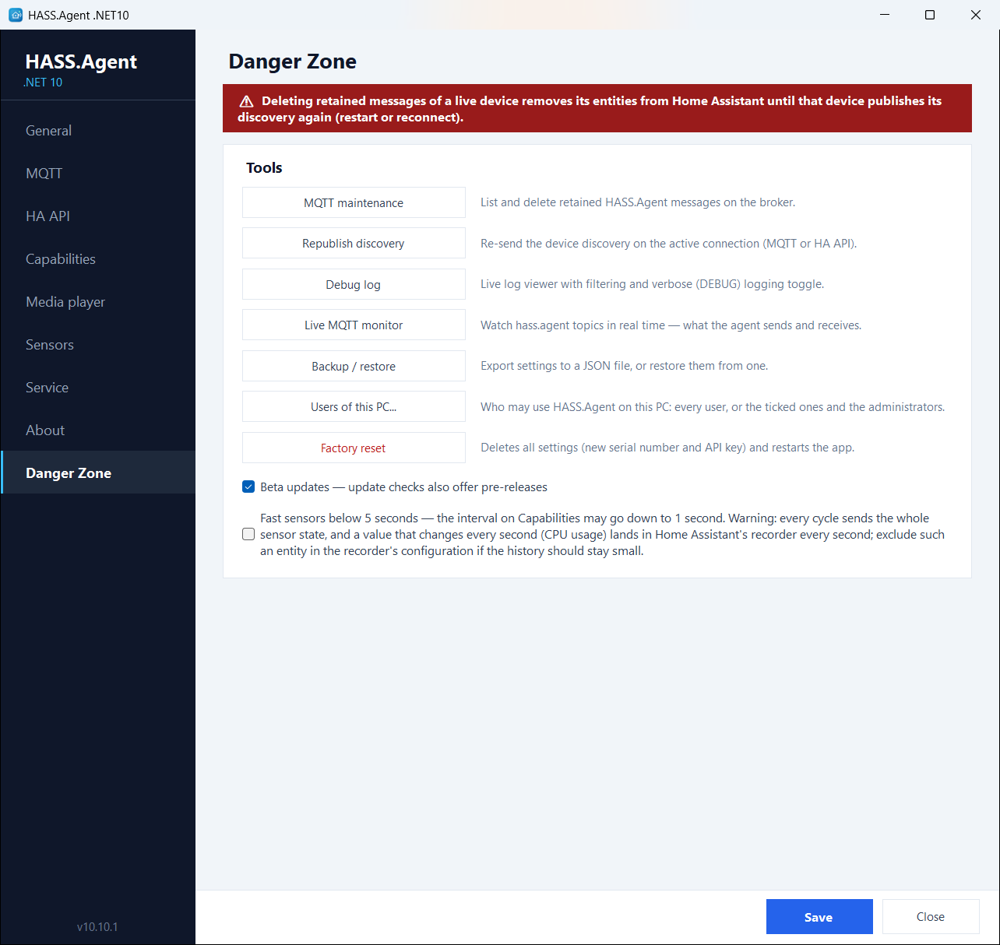
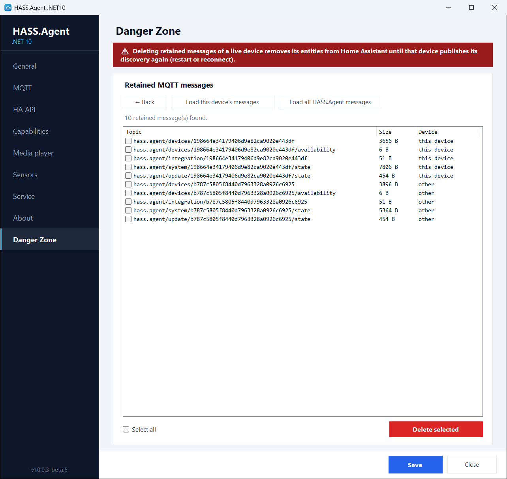
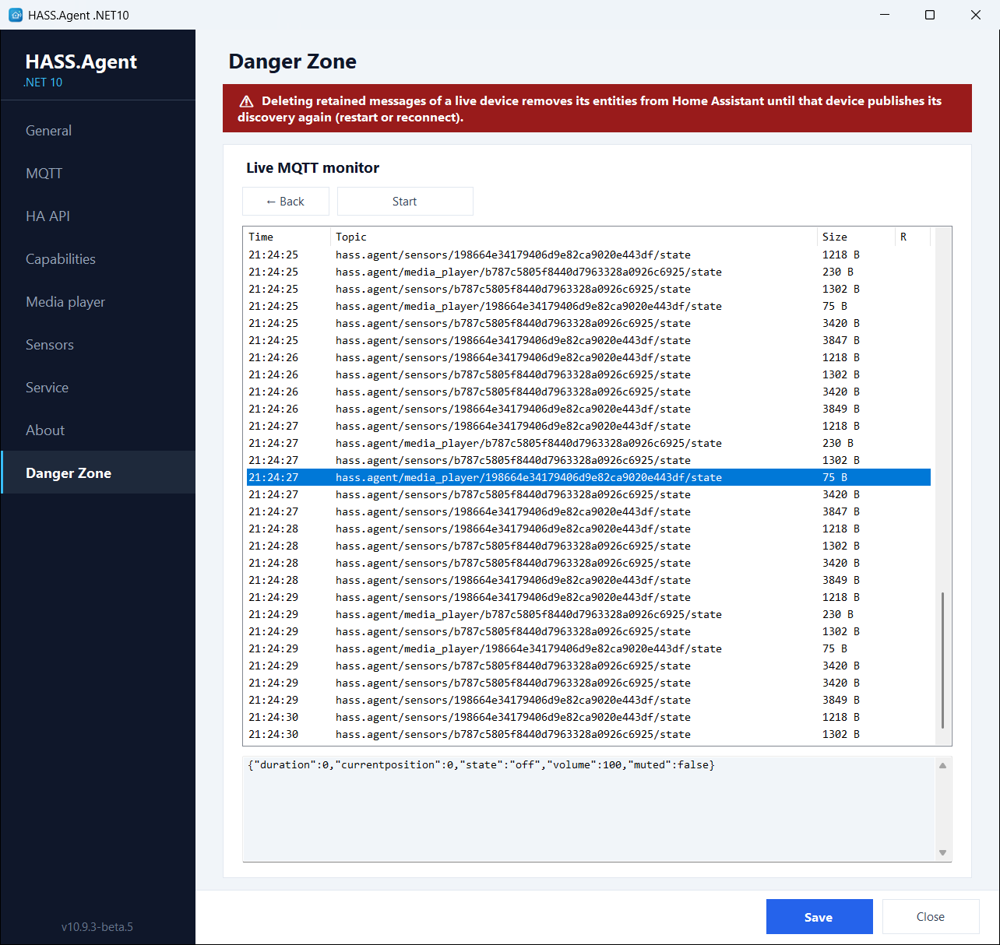
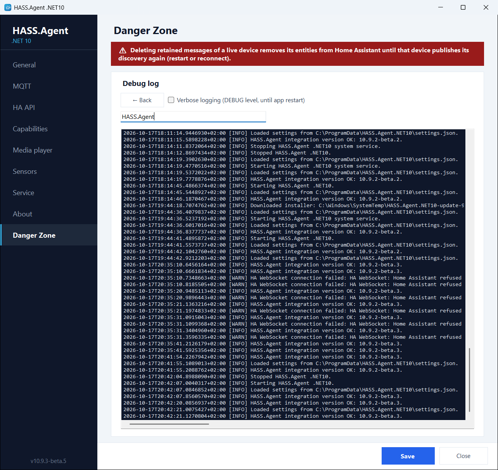
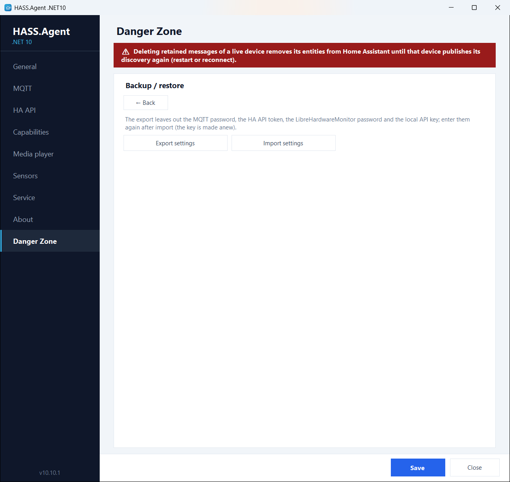

# Danger Zone

An opt-in maintenance and diagnostics toolbox. Enable it with the **Danger Zone** checkbox on the General page and a new page appears with the following tools:

| Tool | What it does |
|------|--------------|
| **MQTT maintenance** | Lists every retained HASS.Agent message on the broker (this device's or all devices') and deletes the selected ones: the cure for ghost entities after renames or reinstalls. |
| **Republish discovery** | Re-sends the device discovery on the active connection (MQTT or HA API) without restarting the app. |
| **Debug log** | Live log viewer with filtering, plus a verbose toggle that enables DEBUG-level logging (including every sent and received MQTT message) until the next restart. |
| **Live MQTT monitor** | Watches the `hass.agent/#` topics in real time with a payload preview: exactly what the app sends and receives. |
| **Backup / restore** | Exports the settings to a portable JSON file and restores them from one. The secrets are left out: the DPAPI-protected MQTT password, HA API token and LibreHardwareMonitor password are machine-bound, and the local API key is made anew by the import when the API is on. |
| **Users of this PC** | Who may use HASS.Agent on this PC: every user, or the ticked ones and the administrators. See [Who may use it on this PC](users.md). |
| **Factory reset** | Deletes all settings after a double confirmation and restarts the app with a fresh serial number. |

Two switches live here as well:

- **Beta updates**: the update checks include GitHub pre-releases, so you can follow the beta channel. Stable users are never offered a pre-release. See [Updates from Home Assistant](updates.md).
- **Fast sensors below 5 seconds** (10.10.0+): the fast [polling profile](../sensors/profiles.md) may go down to 1 second, with a note on what that means for the traffic and for Home Assistant's recorder, which writes a row at every change; a sensor you want every second but not in the history goes on the recorder's exclude list.

<figure class="shot" markdown>
{ width="700" }
<figcaption>The Danger Zone page</figcaption>
</figure>

<figure class="shot" markdown>
{ width="700" }
<figcaption>MQTT maintenance: the retained messages, ready to be deleted</figcaption>
</figure>

<figure class="shot" markdown>
{ width="700" }
<figcaption>The live MQTT monitor</figcaption>
</figure>

<figure class="shot" markdown>
{ width="700" }
<figcaption>The live debug log</figcaption>
</figure>

<figure class="shot" markdown>
{ width="700" }
<figcaption>Backup and restore: the export leaves the secrets out</figcaption>
</figure>
