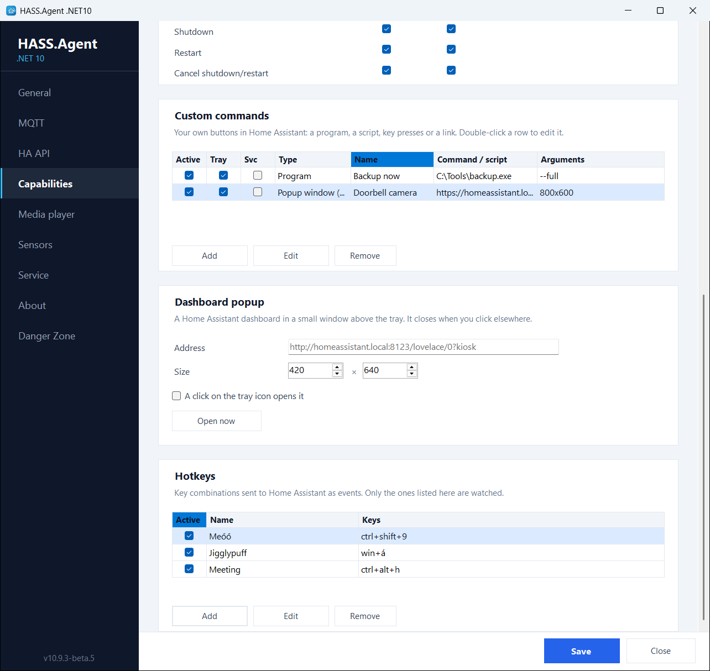

# Dashboard popup

A Home Assistant dashboard, or any web page, in a small window above the tray. Set its address and size on the **Capabilities** page, then open it from the tray menu, or with a click on the tray icon if you tick that. It closes when you click elsewhere, and nothing is loaded while it is closed. Off until an address is set.

<figure class="shot" markdown>
{ width="700" }
<figcaption>Custom commands, dashboard popup and hotkeys on the Capabilities page</figcaption>
</figure>

A dashboard made for it works best: a narrow one with the lights, the thermostat and the cameras you want at hand, in Home Assistant's own **kiosk** or **panel** view so the sidebar stays out of the way. The login is kept per Windows user, so Home Assistant asks for it once. So is the zoom: a level set with Ctrl+scroll (or Ctrl and plus or minus) is there again the next time the popup opens, by address, and Ctrl+0 returns to it.

## Keeping the page loaded

By default the popup loads its page every time it opens, and frees it when it closes. With **Keep the page loaded in the background** ticked (10.13.1+), the popup is only hidden when you click elsewhere: the next click on the tray icon shows the page at once and as you left it, scrolled where it was. The first opening after the app starts still loads it.

The page then lives on while it is out of sight. It keeps its connection to Home Assistant, so what it shows is current when it comes up, and it keeps the memory of a browser tab for as long as the app runs. Changing the address or the size, or clearing the tick, lets the kept page go when the settings are saved. **Open now** always loads a fresh page, with what is in the fields, in a popup of its own; a page kept loaded is left as it is.

## Popup windows from Home Assistant

There is a matching custom command type, **Popup window (WebView)**, that shows a page in a window of its own, for example a camera when the doorbell rings. Each such command can keep its page loaded too, or close its window by itself after a time, and a second type, **Close popup windows**, closes them from an automation; see [Custom commands](../commands/custom.md#popup-windows).

Both use the WebView2 runtime, which ships with Windows 11 and comes with Microsoft Edge on Windows 10; nothing has to be installed for it.
