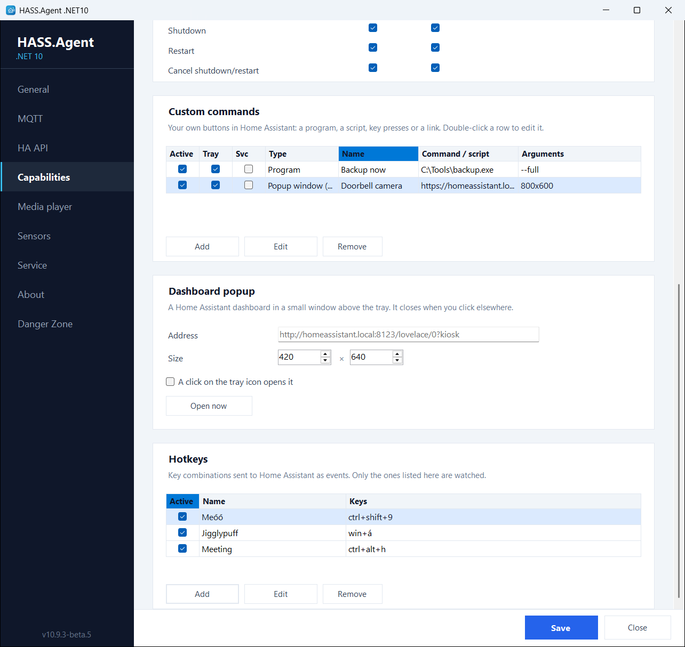

# Dashboard popup

A Home Assistant dashboard, or any web page, in a small window above the tray. Set its address and size on the **Capabilities** page, then open it from the tray menu, or with a click on the tray icon if you tick that. It closes when you click elsewhere, and nothing is loaded while it is closed. Off until an address is set.

<figure class="shot" markdown>
{ width="700" }
<figcaption>Custom commands, dashboard popup and hotkeys on the Capabilities page</figcaption>
</figure>

A dashboard made for it works best: a narrow one with the lights, the thermostat and the cameras you want at hand, in Home Assistant's own **kiosk** or **panel** view so the sidebar stays out of the way. The login is kept per Windows user, so Home Assistant asks for it once.

There is a matching custom command type, **Popup window (WebView)**, that shows a page in a window of its own, for example a camera when the doorbell rings; see [Custom commands](../commands/custom.md).

Both use the WebView2 runtime, which ships with Windows 11 and comes with Microsoft Edge on Windows 10; nothing has to be installed for it.
