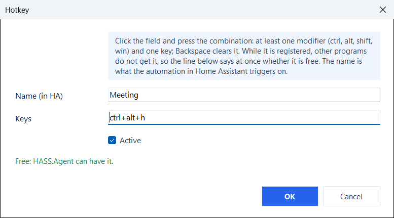

# Hotkeys

> From 10.9.0. The Home Assistant side needs the integration 10.9.0 or newer. On the HA API with a token that is not an administrator's, the connection itself needs the integration 10.9.1 or newer, as for everything else: see [A Home Assistant user for the PC](../connection/index.md#a-home-assistant-user-for-the-pc).

On the **Capabilities** page you can list key combinations with a name (`ctrl+alt+h` as "Meeting"). Pressing one sends an event to Home Assistant, where the device's *Hotkeys* event entity has one event type per hotkey name, so an automation can trigger on it. The integration also fires `hass_agent_hotkey_pressed` on the event bus for every press, on both transports, with the name in `hotkey`; that is the event for automations. (Over the HA API the app carries the press to the integration as a `hass_agent_hotkey` event, which is the transport, not the one to trigger on; over MQTT it goes by topic.)

A hotkey is one combination: at least one of `ctrl`, `alt`, `shift`, `win`, and exactly one other key. The key names are the ones listed under [Custom commands](../commands/custom.md). Only the listed combinations are registered with Windows, nothing else that is typed is seen.

<figure class="shot" markdown>
{ width="520" }
<figcaption>The hotkey editor: the combination is pressed, and the line under it says whether it is free</figcaption>
</figure>

In the hotkey editor (from 10.9.1) the combination is pressed in its field rather than typed; Backspace clears it. The line under the field says at once whether the combination is free:

- **Taken**: Windows or another program already uses it, so it would never reach HASS.Agent. Windows keeps most `win` combinations for itself (`win+1` … `win+9` open the apps of the taskbar, `win+d`, `win+e`, `win+l` and others), and programs such as Discord, Teams, Steam or a graphics card's overlay register their own. A taken combination is kept only when OK is pressed twice; the app tries it again every minute and it starts working once the other program lets it go. A combination Windows keeps for itself does not even show up in the field.
- **Another hotkey of the list** already has it.
- **Free, with one modifier alone** (`ctrl+c`, `alt+f4`, `shift+a`): Windows gives it, but programs use these themselves, and while HASS.Agent holds one they no longer get it. `ctrl+alt` with a letter, a number or an F key is free on most PCs.

An automation on a hotkey:

```yaml
triggers:
  - trigger: event
    event_type: hass_agent_hotkey_pressed
    event_data:
      hotkey: Meeting
actions:
  - action: light.turn_off
    target:
      area_id: office
```

Hotkeys are handled by the tray app: they belong to the logged-in user's keyboard. Shift and Ctrl pick several rows in the list, and **Remove** takes them all (10.9.3+).
