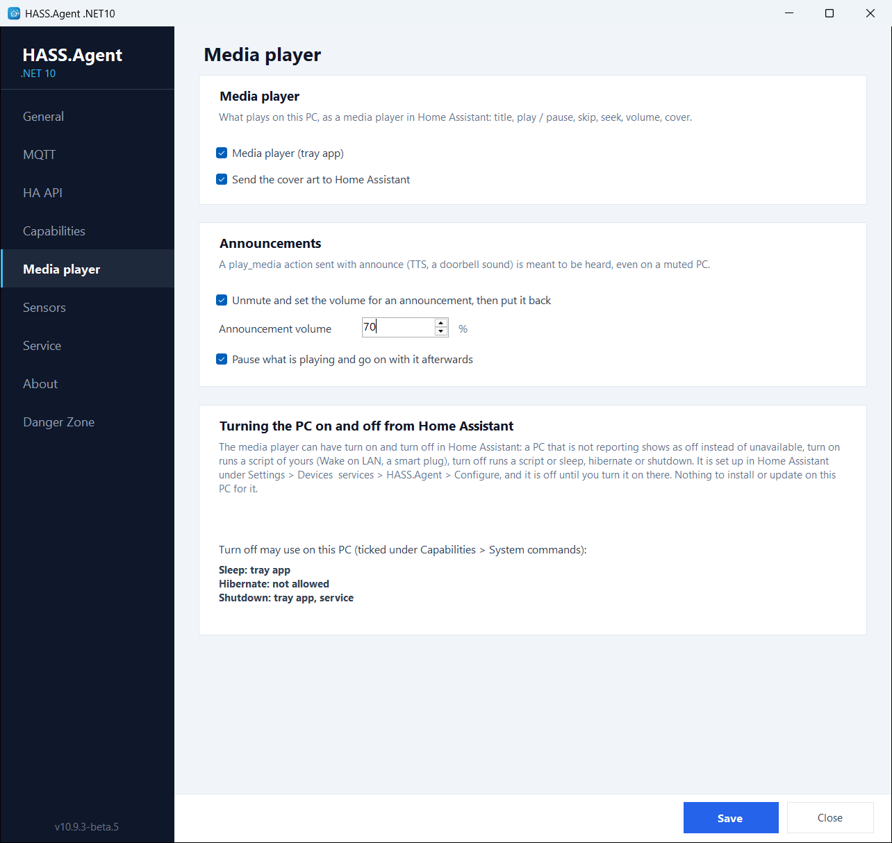

# Media player

The active Windows media session in Home Assistant as a `media_player` entity:

- current title, artist, album and the cover art
- play / pause / stop
- next / previous track
- seek
- volume and mute control
- TTS playback (Home Assistant's TTS engine makes the audio, the PC plays it)
- announcements, which are heard even on a muted PC

The media player uses the Windows global media transport sessions for playback control and the default Windows audio endpoint for volume and mute, so it follows whatever plays: Spotify, a browser, the Movies & TV app, a game. It is handled by the tray app, since the session belongs to the logged-in user.

<figure class="shot" markdown>
{ width="700" }
<figcaption>The Media player page</figcaption>
</figure>

## The Media player page

Its settings are on the **Media player** page of the app (10.10.0+):

- **Media player (tray app)**: the switch for the whole entity.
- **Send the cover art to Home Assistant**: off, the entity keeps the title and the controls but shows no picture. Over the HA API the picture travels as base64 and is a third larger than over MQTT, which is one reason to switch it off.
- **Announcements**: see below.
- **Turning the PC on and off from Home Assistant**: nothing to set on the PC. The media player's *turn on* and *turn off* live in the integration's options in Home Assistant (**Settings → Devices & services → HASS.Agent → Configure**) and are off until you turn them on there; the page tells which of sleep, hibernate and shutdown this PC allows, as ticked under **Capabilities → System commands**. The integration's [Entities](../integration/entities.md#turning-the-pc-on-and-off-with-the-media-player) page explains the options.

## Announcements

> From 10.10.0, with the integration 10.10.0 or newer.

A `media_player.play_media` action sent with `announce: true` (a TTS message, `tts.speak` with the PC as its target, a doorbell sound) is meant to be heard. With **Announcements** on:

1. **Unmute and set the volume for an announcement, then put it back**: the PC is unmuted and set to the **announcement volume** (70 % unless you change it).
2. **Pause what is playing and go on with it afterwards**: what was playing is paused.
3. The sound plays.
4. The volume, the mute and the playback go back to what they were.

Without the flag, `play_media` plays at the current volume, as before. A pause or a stop from Home Assistant while the sound plays cuts it and puts everything back (the card shows pause; `media_player.media_stop` works from an automation). With both boxes off, a muted PC stays silent. An older integration plays the sound at the current volume.

Home Assistant's own TTS sends the flag by itself, so a `tts.speak` aimed at the PC is an announcement:

```yaml
action: tts.speak
target:
  entity_id: tts.google_translate_en_com
data:
  media_player_entity_id: media_player.my_pc
  message: "The washing machine is done."
```

A sound file the same way, with `media_player.play_media` and `announce: true`:

```yaml
action: media_player.play_media
target:
  entity_id: media_player.my_pc
data:
  media_content_id: https://homeassistant.local:8123/local/doorbell.mp3
  media_content_type: music
  announce: true
```

The idea comes from a fork by @VorlonCD.

## Sendspin player (Music Assistant)

> From 10.13.0. Needs Music Assistant 2.10.7 or newer.

The PC can be a player of [Music Assistant](https://music-assistant.io/) over [Sendspin](https://www.sendspin-audio.com/), its protocol for synchronized audio: it plays what Music Assistant sends it, in sync with the other players of its group, in another room, on a speaker, on another PC. This is apart from the media player above, which shows and controls what plays on the PC. In Music Assistant the PC is a player like the others, and Home Assistant gets it from Music Assistant's integration as Music Assistant's own media player, not from this one.

It is off until you turn it on, in the **Sendspin player (Music Assistant)** card on the **Media player** page:

1. Tick **Use this PC as a Sendspin player**, and press **Save**.
2. **Player name**: the name in Music Assistant, the device name when left empty.
3. **Output**: **Windows default**, which follows the default when it changes, or a device of its own by name.
4. Pair it. The player shows up in Music Assistant on its own, and Music Assistant asks for its pairing token. **Copy pairing token** puts it on the clipboard; paste it there.

The status line under the settings says what the player is doing: waiting for Music Assistant, connected, not paired yet, playing (what, and on which output), or what is in the way.

### Connecting

- **Music Assistant finds this PC on the network** (the default): the PC announces itself on the local network (mDNS) and Music Assistant connects to it on port 8928. Setup lets the app through the Windows firewall for this, on private networks only, the same way as the [Local API](../connection/local-api.md). A network set to *Public* in Windows keeps it out.
- **Connect to this Music Assistant**: the PC connects to the address you give: the host or IP address of Music Assistant (`192.168.1.10`), with a port when it is not 8927 (`192.168.1.10:8927`), or a whole `ws://` address. For a network where the PC is not found (another subnet, a VPN, mDNS filtered out).

### Pairing

The connection is encrypted, and Music Assistant only plays to a player it is paired with. The pairing token carries the player's key and a secret of its own; once paired, it is not needed again. **New token** makes another one; the old one no longer pairs, and a Music Assistant already paired stays paired.

The PC is the player, not a Windows user: its keys and pairings are the PC's, next to the settings in `ProgramData\HASS.Agent.NET10\sendspin`, protected for the machine and open to whoever may use the settings ([Who may use it](users.md)). They are not in the settings file, so an export or a backup restored on another PC does not make a second PC with the same player; a factory reset makes a new one.

Only the app in the session at the PC's own screen plays: another user's session, or one over Remote Desktop, says so and stays quiet, and when the screen goes to another user, so does the player. On a [kiosk](kiosk.md) PC, turn the player on and pair it from an account that may change the settings; the kiosk user's app then plays with that pairing.

### Sound

- **The volume** Music Assistant sets is the player's own, not the volume of Windows: what else plays on the PC stays as it is.
- **An output that goes away** (a headset unplugged, a device disabled, a TV that drops its HDMI audio) is no error: the player moves to the default, or waits for its own device and goes on when it is back, and stays in its group meanwhile. With no output at all, the status says so. A TV that is only switched off usually keeps its HDMI audio, and the player plays on into it.
- **An announcement** of the app (see above) silences the player while it plays, when *Pause what is playing* is on, and turns it down otherwise; the group plays on.

### When it does not work

| Status | What to do |
|---|---|
| Waiting for Music Assistant to connect | Music Assistant has not found the PC: check that the network is *Private* in Windows, or use **Connect to this Music Assistant**. |
| Connected, but not paired yet | Paste the pairing token in Music Assistant. |
| This Music Assistant is too old | Update Music Assistant to 2.10.7 or newer. |
| Port 8928 is in use | Another Sendspin player on the PC (such as Sendspin for Windows) has it. The player tries again every half minute, and on **Save**. |
| No output device | Windows has no output to play on; the player goes on when one is back. |
| Not playing here | This app is not in the session at the PC's screen; the one that is plays. |
| This Windows account may not change the settings | A kiosk user's app, with no player set up yet: turn it on and pair it from an account that may change the settings. |

Short gaps with a radio station come from the stream itself: the player fills a gap in what the server sends with silence, so that it stays in time with the others. With the verbose log on ([Danger Zone](danger-zone.md) → **Debug log**), the log of the app shows each one.

## In Home Assistant

The player is one entity of the PC's device, with the cover art on its card, and `media_player.play_media` takes a URL of any audio file the PC can fetch, besides the TTS. [Entities](../integration/entities.md) lists what the integration creates.
