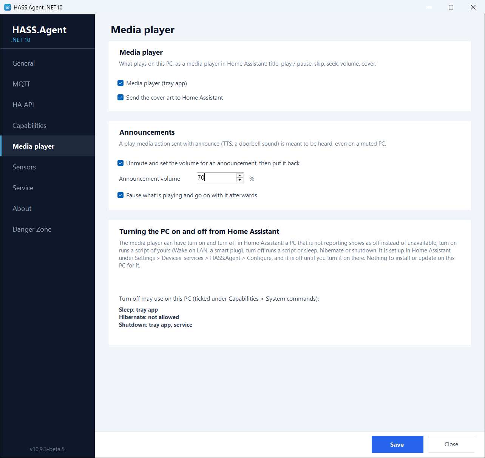

# Media player

The active Windows media session in Home Assistant as a `media_player` entity:

- current title, artist, album and the cover art
- play / pause / stop
- next / previous track
- seek
- volume and mute control
- TTS playback (Home Assistant's TTS engine makes the audio, the PC plays it)
- announcements, which are heard even on a muted PC

The media player uses the Windows global media transport sessions for playback control and the default Windows audio endpoint for volume and mute, so it follows whatever plays: Spotify, a browser, the Movies & TV app, a game. It is handled by the tray app, since the session belongs to the logged-in user.

<figure class="shot" markdown>
{ width="700" }
<figcaption>The Media player page</figcaption>
</figure>

## The Media player page

Its settings are on the **Media player** page of the app (10.10.0+):

- **Media player (tray app)**: the switch for the whole entity.
- **Send the cover art to Home Assistant**: off, the entity keeps the title and the controls but shows no picture. Over the HA API the picture travels as base64 and is a third larger than over MQTT, which is one reason to switch it off.
- **Announcements**: see below.
- **Turning the PC on and off from Home Assistant**: nothing to set on the PC. The media player's *turn on* and *turn off* live in the integration's options in Home Assistant (**Settings → Devices & services → HASS.Agent → Configure**) and are off until you turn them on there; the page tells which of sleep, hibernate and shutdown this PC allows, as ticked under **Capabilities → System commands**. The integration's [Entities](../integration/entities.md#turning-the-pc-on-and-off-with-the-media-player) page explains the options.

## Announcements

> From 10.10.0, with the integration 10.9.2 or newer.

A `media_player.play_media` action sent with `announce: true` (a TTS message, `tts.speak` with the PC as its target, a doorbell sound) is meant to be heard. With **Announcements** on:

1. **Unmute and set the volume for an announcement, then put it back**: the PC is unmuted and set to the **announcement volume** (70 % unless you change it).
2. **Pause what is playing and go on with it afterwards**: what was playing is paused.
3. The sound plays.
4. The volume, the mute and the playback go back to what they were.

Without the flag, `play_media` plays at the current volume, as before. A pause or a stop from Home Assistant while the sound plays cuts it and puts everything back (the card shows pause; `media_player.media_stop` works from an automation). With both boxes off, a muted PC stays silent. An older integration plays the sound at the current volume.

Home Assistant's own TTS sends the flag by itself, so a `tts.speak` aimed at the PC is an announcement:

```yaml
action: tts.speak
target:
  entity_id: tts.google_translate_en_com
data:
  media_player_entity_id: media_player.my_pc
  message: "The washing machine is done."
```

A sound file the same way, with `media_player.play_media` and `announce: true`:

```yaml
action: media_player.play_media
target:
  entity_id: media_player.my_pc
data:
  media_content_id: https://homeassistant.local:8123/local/doorbell.mp3
  media_content_type: music
  announce: true
```

The idea comes from a fork by @VorlonCD.

## In Home Assistant

The player is one entity of the PC's device, with the cover art on its card, and `media_player.play_media` takes a URL of any audio file the PC can fetch, besides the TTS. [Entities](../integration/entities.md) lists what the integration creates.
