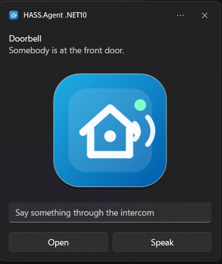
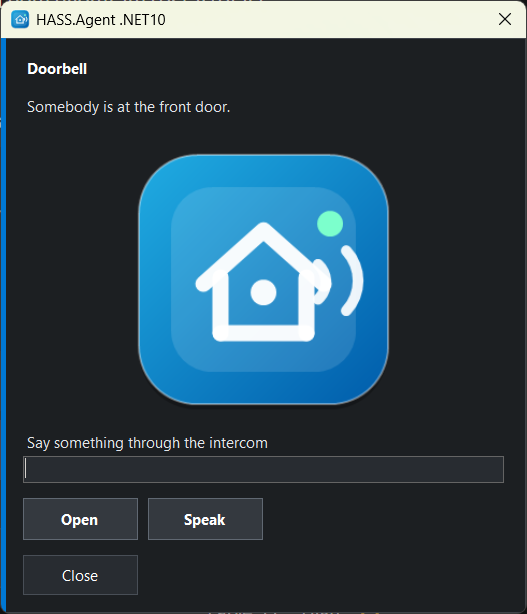
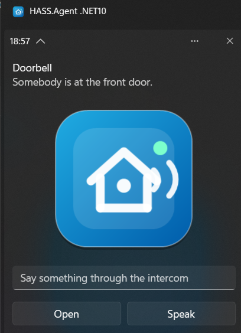

# Notifications

Receive Home Assistant notifications on Windows, as a Windows notification or in the app's own window.

<figure class="shot" markdown>
{ width="360" }
{ width="400" }
<figcaption>The same notification as a Windows notification and in the app's own window</figcaption>
</figure>

Supports actionable notifications: buttons on the notification send an action event back to Home Assistant, so automations can react to user choices.

```yaml
action: hass_agent.send_notification
target:
  entity_id: notify.my_pc_notifications
data:
  title: Home Assistant
  message: "Would you like to turn on the lights?"
  actions:
    - action: lights_on
      title: "Turn on"
    - action: lights_off
      title: "Turn off"
```

Button presses arrive in Home Assistant on the device's *Notification actions* event entity, and as a `hass_agent_notifications` event on the event bus.

## Pictures, text fields and more

> From 10.9.0.

Besides `message` and `title`, the action takes these fields. In the Home Assistant editor each has an input of its own (integration 10.9.0 or newer; with an older one they go inside a `data` object of the action, which still works):

| Field | What it does |
|-------|--------------|
| `actions` | Buttons, each with an `action` (what comes back) and a `title` (what the button says). Up to five. |
| `image` | A picture to show: a web address. With the integration 10.9.0 or newer also a path on Home Assistant (`/local/doorbell.jpg`, `/api/camera_proxy/camera.front_door`) or simply a camera or image entity (`camera.front_door`); the integration makes it fetchable for a few minutes, and the PC keeps its own copy. |
| `inputs` | Text fields, each with an `id` and a `title` (the hint shown in the empty field). Up to five. What was typed comes back with the pressed button, in `input`, by id. With no button of your own, a *Send* button is added, and its action is `reply`. |
| `duration` | Seconds on screen, 1 to 60 (default 10). Windows knows two lengths for its own notifications: above 10 it uses the long one, about 25 seconds. |
| `style` | `toast` or `window`: the [notification style](#notification-style) for this one notification, whatever the setting says. |

```yaml
action: hass_agent.send_notification
target:
  entity_id: notify.my_pc_notifications
data:
  title: Doorbell
  message: "Somebody is at the front door."
  image: camera.front_door
  style: window
  duration: 30
  inputs:
    - id: answer
      title: "Say something through the intercom"
  actions:
    - action: open_door
      title: "Open"
    - action: speak
      title: "Speak"
```

The event for the pressed button then carries what was typed:

```yaml
action: speak
input:
  answer: "Leave it at the door, please"
device_name: MY-PC
```

## Notification style

> From 10.9.0.

The **Notification style** on the Capabilities page decides how a notification is shown:

- **Windows notification** (the default). Windows shows it like any other notification: it follows Do not disturb and focus sessions, it is held back while a full-screen game or a presentation runs, and it stays in the notification centre afterwards, where its buttons still work. If notifications are turned off for HASS.Agent in the Windows settings, the app uses its own window instead.
- **Own window.** A small always-on-top window in the corner of the screen, visible whatever Windows is doing. It does not take the keyboard focus when it appears, and it closes on its own after the duration, unless somebody has started typing into it.

A single notification can choose with `style`, so the doorbell can use the window while everything else stays a Windows notification.

**Custom name** (10.9.3+), right below: the name above the Windows notifications and the title of the app's own window, *HASS.Agent .NET10* unless you tick it and write your own, for example to tell several PCs apart. Windows keeps that name in the app's registration, which the app writes again at every start, so the app puts your name back each time. It is one name for all notifications of the PC. Windows keeps the name it read for the app while the app has notifications in the notification centre, so saving a changed name clears the app's notifications from there; the next one shows the new name.

<figure class="shot" markdown>
{ width="360" }
<figcaption>It stays in the notification centre, buttons and all</figcaption>
</figure>

## Where the notifications go

Notifications are handled by the tray app, in the session of the logged-in user: the Windows service has no screen to show them on. On a PC with nobody logged in a notification is lost; an automation that must not lose one can check the PC's *Session state* or *Logged in user* sensor first.

The Home Assistant side is the integration's `notify` entity and its `hass_agent.send_notification` action: [Services](../integration/services.md).
