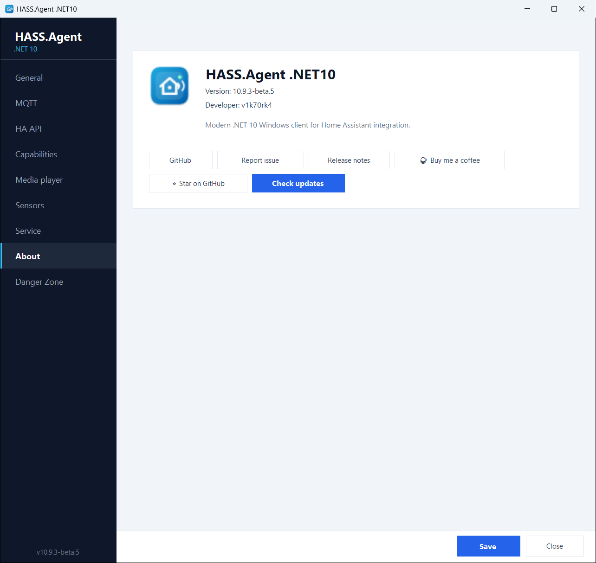

# Updates from Home Assistant

When a new release is available, the app publishes an **update entity** to Home Assistant with a working **Install** button and a **Check for updates** button next to it. With the integration 10.7.3 or newer the integration builds the entity on both transports; with an older integration it comes from Home Assistant's own MQTT discovery (and, on the HA API transport, from the app's events, 10.6.7+).

<figure class="shot" markdown>
{ width="500" }
<figcaption>The update entity with its Install button</figcaption>
</figure>

With the Windows service installed, the update is downloaded and applied **fully silently** (no UAC prompt), also when nobody is logged in; a tray app that was running comes back by itself when the installer is done. Without the service a UAC prompt appears on the PC. Home Assistant receives a **persistent notification** for the progress and the result. A finished update is reported by the service when it is installed, also when nobody was logged in, and by the tray app when it is not.

<figure class="shot" markdown>
{ width="500" }
<figcaption>The notification when it is done</figcaption>
</figure>

## Only signed installers

A downloaded installer is started only when it carries the publisher's Authenticode signature (*Open Source Developer Viktor Révész*, issued by *Certum Code Signing 2021 CA*, with a valid timestamp and a certificate that has not been revoked). Anything else, a damaged download or a release file replaced by someone else, is deleted and the update stops, with the reason in the log and in Home Assistant. The publisher is checked by name rather than by certificate, so a renewed certificate keeps updates working. [Security and privacy](../getting-started/security.md) has the certificate.

The file must also be the installer of the release it was downloaded for: it says so in its version information, which the signature covers. An older installer put under a newer release, or another file the publisher signed, is refused the same way.

**Check for updates** in Home Assistant asks GitHub at most once in five minutes; pressed again sooner, it sends the last answer.

## Updates only at the PC

Where a change of software has to be approved at the PC itself, tick **Updates only at this PC** (10.13.1+) on the [Danger Zone](danger-zone.md) page. An install asked for from Home Assistant is then refused before the release is looked up or anything is downloaded: on MQTT and on the HA API, by the tray app and by the service. Home Assistant gets a notification saying so, and with the integration 10.13.1 or newer the update entity shows the new version without an Install button. The tick is saved as you make it and holds from then on: the service takes it up within a second, and nothing needs a restart. Update checks, the notice in the tray and the About page work as before, so the PC still tells you when there is something to install.

It is off unless you tick it, and for most PCs it is better left off. What Home Assistant can ask for is narrow: the PC fetches the installer itself from the release on GitHub and starts it only with the publisher's signature (below), it never goes back to an older version, and whether betas are offered is a setting on the PC. The most a Home Assistant in the wrong hands can do on this path is make the PC install the newest signed release, the one it would offer its owner anyway. The app carries its own .NET runtime, so the monthly .NET security fixes reach a PC only with an update of the app; a PC that waits for someone to sit down at it stays behind longer.

## The About page

You can also check for updates from the **About** page, which shows the installed version, the latest release and a one-click download. The update prompt shows the release notes, with a link to the full notes on GitHub, and asks **Download / Not now**, then **Install now / Later**.

<figure class="shot" markdown>
{ width="700" }
<figcaption>The About page</figcaption>
</figure>

The update check runs every six hours, and once more a minute after a failed one (right after boot the network is often not ready yet). The app talks to GitHub for nothing else.

## The beta channel

The **Beta updates** switch on the [Danger Zone](danger-zone.md) page makes the update checks include GitHub pre-releases, so you can follow the beta channel; the update entity and the About page then offer the newest beta. Stable users are never offered a pre-release. A beta is signed like a release.
