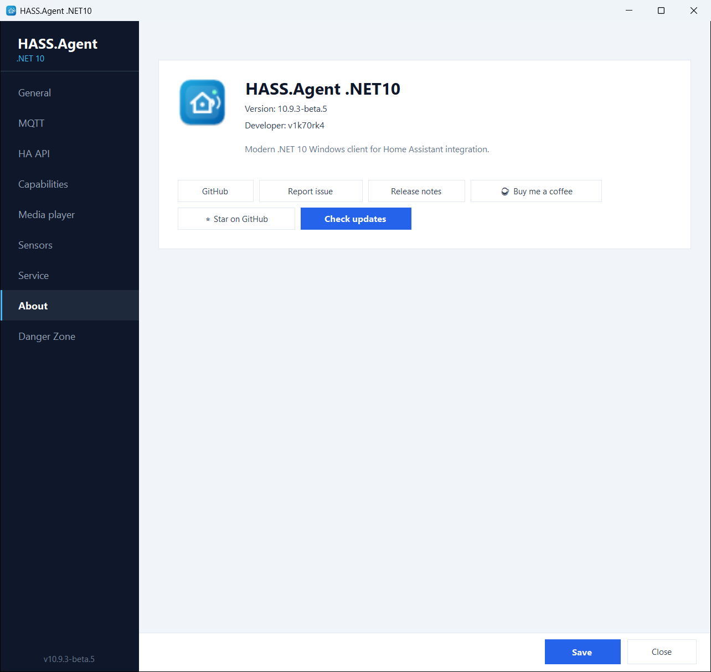

# Updates from Home Assistant

When a new release is available, the app publishes an **update entity** to Home Assistant with a working **Install** button and a **Check for updates** button next to it. With the integration 10.7.3 or newer the integration builds the entity on both transports; with an older integration it comes from Home Assistant's own MQTT discovery (and, on the HA API transport, from the app's events, 10.6.7+).

<figure class="shot" markdown>
{ width="500" }
<figcaption>The update entity with its Install button</figcaption>
</figure>

With the Windows service installed, the update is downloaded and applied **fully silently** (no UAC prompt), also when nobody is logged in; a tray app that was running comes back by itself when the installer is done. Without the service a UAC prompt appears on the PC. Home Assistant receives a **persistent notification** for the progress and the result. A finished update is reported by the service when it is installed, also when nobody was logged in, and by the tray app when it is not.

<figure class="shot" markdown>
{ width="500" }
<figcaption>The notification when it is done</figcaption>
</figure>

## Only signed installers

A downloaded installer is started only when it carries the publisher's Authenticode signature (*Open Source Developer Viktor Révész*, issued by *Certum Code Signing 2021 CA*, with a valid timestamp and a certificate that has not been revoked). Anything else, a damaged download or a release file replaced by someone else, is deleted and the update stops, with the reason in the log and in Home Assistant. The publisher is checked by name rather than by certificate, so a renewed certificate keeps updates working. [Security and privacy](../getting-started/security.md) has the certificate.

## The About page

You can also check for updates from the **About** page, which shows the installed version, the latest release and a one-click download. The update prompt shows the release notes, with a link to the full notes on GitHub, and asks **Download / Not now**, then **Install now / Later**.

<figure class="shot" markdown>
{ width="700" }
<figcaption>The About page</figcaption>
</figure>

The update check runs every six hours, and once more a minute after a failed one (right after boot the network is often not ready yet). The app talks to GitHub for nothing else.

## The beta channel

The **Beta updates** switch on the [Danger Zone](danger-zone.md) page makes the update checks include GitHub pre-releases, so you can follow the beta channel; the update entity and the About page then offer the newest beta. Stable users are never offered a pre-release. A beta is signed like a release.
