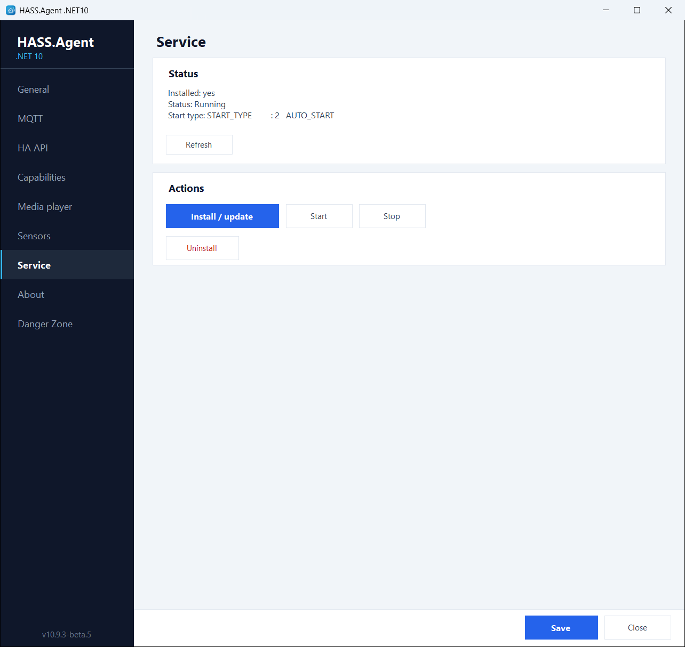
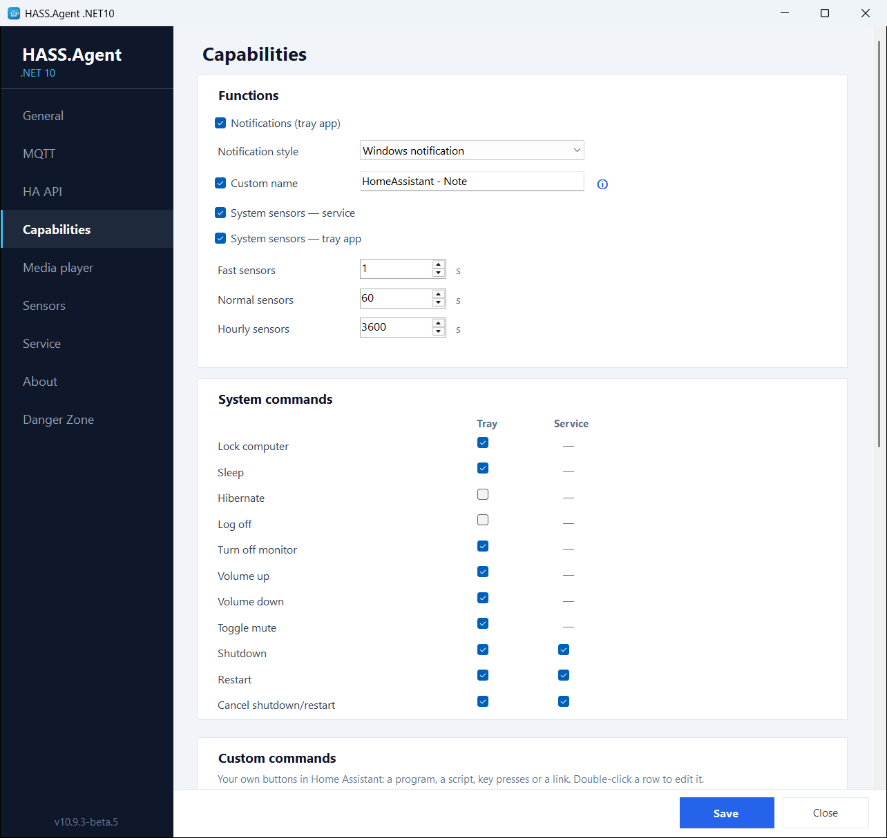

# Windows service

The same executable can run as a tray app or as a Windows service. Use the **Service** page to install, start, stop or uninstall the service; UAC elevation is requested when it is needed. The installer can install it too.

<figure class="shot" markdown>
{ width="700" }
<figcaption>The Service page</figcaption>
</figure>

**The service** handles what should work even when nobody is logged in:

- shutdown, restart, restart cancel
- the system sensors (CPU, memory, drives, network, battery and so on), and the ones only an administrator can read, such as [Drive health](../sensors/index.md)
- custom sensors (a process, a service, a drive, a command, LibreHardwareMonitor)
- custom commands that need no desktop
- updates, silently and with nobody logged in ([Updates from Home Assistant](updates.md))

**The tray app** handles what belongs to the logged-in user's session:

- notifications, the dashboard popup, hotkeys
- the media player, the display, the audio devices
- the active window and process, the clipboard, the idle time, the session state
- commands that need the desktop: key presses, links, popup windows

The service and the tray app each announce themselves to Home Assistant, and the integration routes a command to whichever handles it. With both running, a sensor ticked for both is read by both; tick the service alone for what should survive a logout.

## The Capabilities page

The **Capabilities** page is where the split is made: for every feature and every system command, a **Tray** and a **Svc** box. The page also holds the notification style and the custom name, the dashboard popup, the custom commands and the hotkeys, and the intervals of the [polling profiles](../sensors/profiles.md).

<figure class="shot" markdown>
{ width="700" }
<figcaption>Features and system commands, each for the tray app, the service or both</figcaption>
</figure>

## Commands the service runs

> From 10.9.1.

The service runs as SYSTEM, so it runs a custom command or a command sensor set for the service only when an administrator has approved it. The approvals are kept in `service-policy.json` next to the program, which only administrators can change, each by its id and what it runs. Updating the app or installing the service keeps what was approved before, as long as it is unchanged, and approves nothing new: anyone who can write the settings could have put it there. A command or command sensor added or changed for the service asks for administrator approval (UAC) when the settings are saved, and the prompt lists what each one runs; until it is approved the service leaves it to the tray app, and the log says which ones. If the settings change while Windows asks for the administrator, nothing is approved. The **Test** button in the editor always runs it in the tray app, as you, never as SYSTEM. (An update from 10.9.0 or older, which had no approvals yet, approves the current settings once.) The built-in sensors and the harmless custom sensor types (process, service, drive) need no approval.

## Logs

The log is `hass-agent-net10.log` in `C:\ProgramData\HASS.Agent.NET10`, which the **Open folder** button of the General page opens; the Danger Zone's [debug log](danger-zone.md) shows it live, with a verbose switch.
