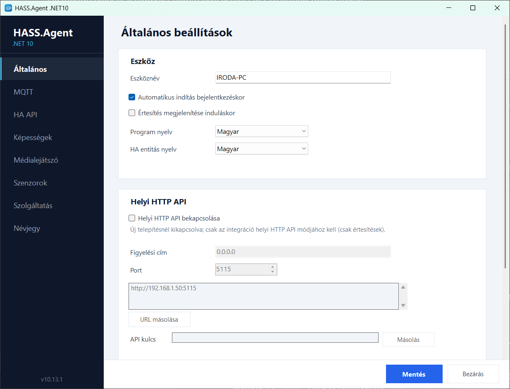

<div class="hero" markdown>

{ .logo }

<p class="eyebrow">.NET 10 · WINDOWS 10 / 11 · MAGYARUL IS</p>

# HASS.Agent .NET10

<p class="tag">Modern, könnyű Windows-társalkalmazás a Home Assistanthoz: értesítések, médiavezérlés, szenzorok, parancsok és frissítés egy kattintással.</p>

[:material-download: Letöltés](https://github.com/v1k70rk4/HASS.Agent.NET10/releases/latest){ .md-button .md-button--primary }
[:material-rocket-launch: Első lépések (angolul)](../getting-started/index.md){ .md-button }
[:material-github: GitHub](https://github.com/v1k70rk4/HASS.Agent.NET10){ .md-button }

vagy `winget install v1k70rk4.HASSAgentNET10`

</div>

## Mit tud?

A Windows-gépeidet a Home Assistantból látod és vezérled. A program a tálcán fut, mellé egy rendszerszolgáltatás is telepíthető arra, aminek bejelentkezés nélkül is működnie kell.

<div class="grid cards" markdown>

-   :material-bell-ring:{ .lg .middle } **Értesítések**

    ---

    A Home Assistant értesítései Windows-értesítésként vagy a program saját, mindig látható ablakában: képpel, gombokkal, és szöveges válasszal, ami visszajut a Home Assistantba.

-   :material-music:{ .lg .middle } **Médialejátszó**

    ---

    Ami a gépen szól, az a Home Assistantban is ott van: lejátszás, szünet, léptetés, hangerő, borítókép. A felolvasott (TTS) üzenet némított gépen is hallatszik.

-   :material-chart-line:{ .lg .middle } **Szenzorok**

    ---

    Beépített rendszerszenzorok, és a sajátjaid: egy folyamat, egy szolgáltatás, egy meghajtó, egy szkript kimenete, egy LibreHardwareMonitor-érték.

-   :material-lightning-bolt:{ .lg .middle } **Parancsok**

    ---

    Zárolás, alvás, leállítás, újraindítás, és saját gombok: programok, PowerShell-szkriptek, billentyűleütések, hivatkozások. Automatizmusból vagy az irányítópultról.

-   :material-dock-window:{ .lg .middle } **Irányítópult**

    ---

    A Home Assistant irányítópultja egy kis ablakban a tálca fölött, egy kattintásra. Vagy bármelyik oldal saját ablakban, például a kamera képe, amikor csöngetnek.

-   :material-keyboard:{ .lg .middle } **Gyorsbillentyűk**

    ---

    Egy billentyűkombináció nevet kap, és esemény lesz belőle a Home Assistantban: bármelyik automatizmus indítható a billentyűzetről.

-   :material-update:{ .lg .middle } **Frissítés a Home Assistantból**

    ---

    A frissítés entitásnak valódi **Telepítés** gombja van. A rendszerszolgáltatással a frissítés csendben megy végbe, és csak a kiadó aláírásával ellátott telepítő fut le.

-   :material-shield-check:{ .lg .middle } **Biztonság**

    ---

    A gépnek nem kell adminisztrátori token: saját, nem adminisztrátor Home Assistant-felhasználóval dolgozik. Minden kiadás alá van írva, a programban nincs telemetria.

</div>

## Magyarul beszél

A program felülete magyar: magyar Windowson magától így indul, máskülönben az **Általános** oldalon, a **Program nyelv** alatt választható. Az entitások neve a Home Assistantban ettől függetlenül állítható (**HA entitás nyelv**).

<figure class="shot" markdown>
{ width="700" }
<figcaption>Az Általános oldal magyarul</figcaption>
</figure>

## Telepítés három lépésben

Kell hozzá Windows 11 vagy Windows 10 (2004-es vagy újabb, x64), Home Assistant 2026.6 vagy újabb, és egy MQTT-bróker **vagy** a Home Assistant WebSocket API-ja. Az utóbbihoz nem kell bróker, és távolról is működik, például a Nabu Casán át.

1. **Az integráció.** A Home Assistantban nyisd meg a **Beállítások → Közösségi tár** oldalt (a 2026.11 előtti Home Assistantban ez a HACS), keresd meg a **HASS.Agent** integrációt, töltsd le, és indítsd újra a Home Assistantot.

    [](https://my.home-assistant.io/redirect/hacs_repository/?owner=v1k70rk4&repository=HASS.Agent.NET10-Integration&category=integration)

2. **A Windows-program.** Telepítsd wingettel, vagy töltsd le az aláírt telepítőt a [kiadások oldaláról](https://github.com/v1k70rk4/HASS.Agent.NET10/releases/latest):

    ```powershell
    winget install v1k70rk4.HASSAgentNET10
    ```

    A program a tálcán lakik: az ikonjára kattintva nyílnak a beállítások.

3. **Az összekötés.** Az **MQTT** oldalon add meg a bróker címét és egy belépést, vagy a **HA API** oldalon a Home Assistant címét és egy hosszú életű hozzáférési tokent. MQTT-n a gép magától megjelenik a Home Assistant **Eszközök és szolgáltatások** oldalán, a felfedezett eszközök között. A HA API-n az első gépet az integráció hozzáadásával kell felvenni (**HASS.Agent → HA API (WebSocket)**), a többit már a Home Assistant találja meg.

## Tovább

A részletes dokumentáció angol nyelvű:

- [Get started](../getting-started/index.md): a telepítés lépései részletesen
- [Features](../features/index.md): minden funkció, képekkel
- [Connection modes](../connection/index.md): MQTT, HA API, vagy mindkettő
- [Coming from HASS.Agent](../getting-started/migrating.md): ha az eredeti HASS.Agentről váltanál
- [Translating](../translating.md): ha javítanál a fordításon

A program ingyenes és nyílt forráskódú (MIT-licenc). Nem áll kapcsolatban a Home Assistant projekttel.
