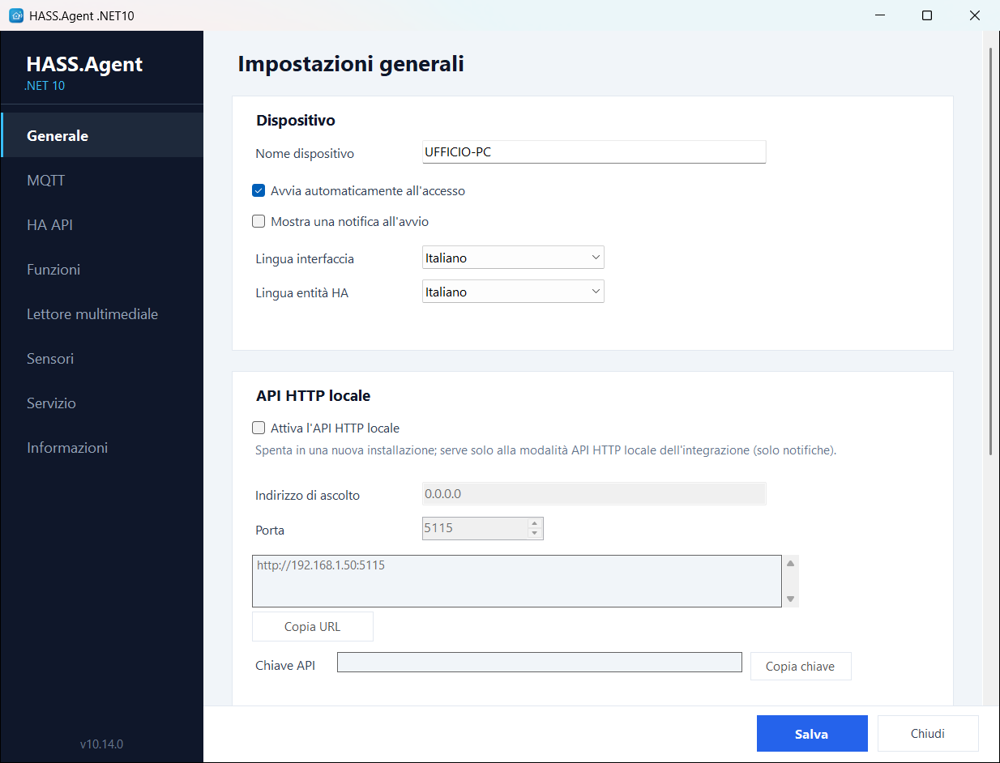

<div class="hero" markdown>

{ .logo }

<p class="eyebrow">.NET 10 · WINDOWS 10 / 11 · ANCHE IN ITALIANO</p>

# HASS.Agent .NET10

<p class="tag">Un compagno Windows moderno e leggero per Home Assistant: notifiche, controllo multimediale, sensori, comandi e aggiornamenti con un clic.</p>

[:material-download: Scarica](https://github.com/v1k70rk4/HASS.Agent.NET10/releases/latest){ .md-button .md-button--primary }
[:material-rocket-launch: Primi passi (in inglese)](../getting-started/index.md){ .md-button }
[:material-github: GitHub](https://github.com/v1k70rk4/HASS.Agent.NET10){ .md-button }

oppure `winget install v1k70rk4.HASSAgentNET10`

</div>

## Cosa sa fare?

Vedi e controlli i tuoi PC Windows da Home Assistant. L'app vive nell'area di notifica; in più si può installare un servizio di sistema, per tutto ciò che deve funzionare anche senza un utente connesso.

<div class="grid cards" markdown>

-   :material-bell-ring:{ .lg .middle } **Notifiche**

    ---

    Le notifiche di Home Assistant come notifiche di Windows, oppure in una finestra dell'app sempre in primo piano: con immagini, pulsanti e risposte di testo che tornano a Home Assistant.

-   :material-music:{ .lg .middle } **Lettore multimediale**

    ---

    Quello che è in riproduzione sul PC c'è anche in Home Assistant: riproduzione, pausa, cambio di brano, volume, copertina. Gli annunci TTS si sentono anche su un PC con l'audio disattivato.

-   :material-chart-line:{ .lg .middle } **Sensori**

    ---

    Sensori di sistema integrati e i tuoi: un processo, un servizio, un'unità, l'output di uno script, un valore di LibreHardwareMonitor.

-   :material-lightning-bolt:{ .lg .middle } **Comandi**

    ---

    Blocco, sospensione, arresto, riavvio, e pulsanti tuoi: programmi, script PowerShell, pressioni di tasti, link. Dalle automazioni o dalla dashboard.

-   :material-dock-window:{ .lg .middle } **Dashboard**

    ---

    La tua dashboard di Home Assistant in una piccola finestra sopra l'area di notifica, a un clic di distanza. Oppure una pagina qualsiasi in una finestra a sé, per esempio l'immagine della telecamera quando suonano alla porta.

-   :material-keyboard:{ .lg .middle } **Tasti di scelta rapida**

    ---

    Una combinazione di tasti riceve un nome e diventa un evento in Home Assistant: così avvii qualsiasi automazione dalla tastiera.

-   :material-update:{ .lg .middle } **Aggiornamenti da Home Assistant**

    ---

    L'entità di aggiornamento ha un vero pulsante **Installa**. Con il servizio di sistema l'aggiornamento avviene in silenzio, in background, e viene eseguito solo un programma di installazione che porta la firma dell'editore.

-   :material-shield-check:{ .lg .middle } **Sicurezza**

    ---

    Il PC non ha bisogno di un token da amministratore: lavora con un proprio utente di Home Assistant, senza diritti di amministratore. Ogni versione è firmata, l'app non contiene telemetria.

</div>

## Parla italiano

L'interfaccia dell'app è in italiano: su un Windows in italiano parte così da sola, altrimenti la lingua si sceglie nella pagina **Generale**, alla voce **Lingua interfaccia**. I nomi delle entità in Home Assistant si impostano a parte (**Lingua entità HA**).

<figure class="shot" markdown>
{ width="700" }
<figcaption>La pagina «Generale» in italiano</figcaption>
</figure>

## Installazione in tre passi

Ti servono Windows 11 o Windows 10 (versione 2004 o successiva, x64), Home Assistant 2026.6 o successivo e un broker MQTT **oppure** l'API WebSocket di Home Assistant. Per l'API non serve un broker, e funziona anche fuori casa, per esempio tramite Nabu Casa.

1. **L'integrazione.** In Home Assistant apri il **Marketplace** in **Impostazioni** (in Home Assistant prima della 2026.11 è HACS), cerca l'integrazione **HASS.Agent**, scaricala e riavvia Home Assistant.

    [](https://my.home-assistant.io/redirect/hacs_repository/?owner=v1k70rk4&repository=HASS.Agent.NET10-Integration&category=integration)

2. **L'app per Windows.** Installala con winget, oppure scarica il programma di installazione firmato dalla [pagina delle release](https://github.com/v1k70rk4/HASS.Agent.NET10/releases/latest):

    ```powershell
    winget install v1k70rk4.HASSAgentNET10
    ```

    L'app vive nell'area di notifica: un doppio clic sulla sua icona apre le impostazioni.

3. **La connessione.** Nella pagina **MQTT** inserisci l'indirizzo del broker e le credenziali, oppure nella pagina **HA API** l'indirizzo di Home Assistant e un token di accesso a lunga durata. Con MQTT il PC compare da solo in Home Assistant in **Dispositivi e servizi**, tra i dispositivi rilevati. Con l'HA API il primo PC si aggiunge aggiungendo l'integrazione (**HASS.Agent → HA API (WebSocket)**), tutti gli altri li trova Home Assistant da solo.

## E adesso?

La documentazione completa è in inglese:

- [Get started](../getting-started/index.md): l'installazione passo per passo
- [Features](../features/index.md): tutte le funzioni, con immagini
- [Connection modes](../connection/index.md): MQTT, HA API o entrambi
- [Coming from HASS.Agent](../getting-started/migrating.md): se arrivi dall'HASS.Agent originale
- [Translating](../translating.md): se vuoi migliorare la traduzione

L'app è gratuita e open source (licenza MIT). Non è collegata al progetto Home Assistant.
