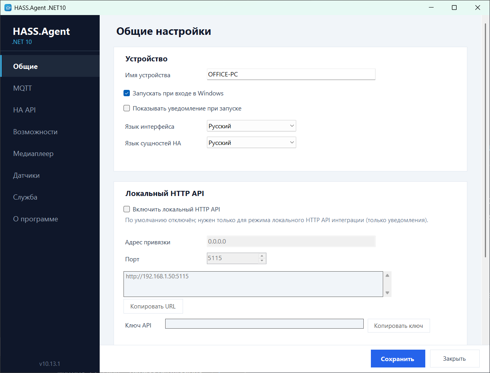

<div class="hero" markdown>

{ .logo }

<p class="eyebrow">.NET 10 · WINDOWS 10 / 11 · И НА РУССКОМ</p>

# HASS.Agent .NET10

<p class="tag">Современный лёгкий компаньон Windows для Home Assistant: уведомления, управление медиа, датчики, команды и обновление в один клик.</p>

[:material-download: Скачать](https://github.com/v1k70rk4/HASS.Agent.NET10/releases/latest){ .md-button .md-button--primary }
[:material-rocket-launch: Первые шаги (на английском)](../getting-started/index.md){ .md-button }
[:material-github: GitHub](https://github.com/v1k70rk4/HASS.Agent.NET10){ .md-button }

или `winget install v1k70rk4.HASSAgentNET10`

</div>

## Что умеет

Ваши компьютеры с Windows видны в Home Assistant и управляются из него. Приложение работает в области уведомлений (трее); к нему можно установить системную службу для того, что должно работать и без входа в систему.

<div class="grid cards" markdown>

-   :material-bell-ring:{ .lg .middle } **Уведомления**

    ---

    Уведомления Home Assistant как уведомления Windows или в собственном, всегда видимом окне приложения: с картинками, кнопками и текстовыми ответами, которые возвращаются в Home Assistant.

-   :material-music:{ .lg .middle } **Медиаплеер**

    ---

    То, что играет на компьютере, видно и в Home Assistant: воспроизведение, пауза, переход по трекам, громкость, обложка. Голосовые объявления (TTS) слышны даже при выключенном звуке.

-   :material-chart-line:{ .lg .middle } **Датчики**

    ---

    Встроенные системные датчики и ваши собственные: процесс, служба, диск, вывод скрипта, значение из LibreHardwareMonitor.

-   :material-lightning-bolt:{ .lg .middle } **Команды**

    ---

    Блокировка, сон, выключение, перезагрузка и собственные кнопки: программы, скрипты PowerShell, нажатия клавиш, ссылки. Из автоматизаций или с панели управления.

-   :material-dock-window:{ .lg .middle } **Панель управления**

    ---

    Панель Home Assistant в небольшом окне над треем, в один клик. Или любая страница в отдельном окне, например изображение с камеры, когда звонят в дверь.

-   :material-keyboard:{ .lg .middle } **Горячие клавиши**

    ---

    Сочетание клавиш получает имя и становится событием в Home Assistant: любую автоматизацию можно запустить с клавиатуры.

-   :material-update:{ .lg .middle } **Обновление из Home Assistant**

    ---

    У сущности обновления есть настоящая кнопка **Установить**. С системной службой обновление проходит незаметно, и запускается только установщик с подписью издателя.

-   :material-shield-check:{ .lg .middle } **Безопасность**

    ---

    Компьютеру не нужен токен администратора: он работает с собственным пользователем Home Assistant без прав администратора. Каждый выпуск подписан, телеметрии в приложении нет.

</div>

## Говорит по-русски

Интерфейс приложения переведён на русский: в русской Windows оно само запускается на русском, а иначе язык выбирается на странице **Общие**, в поле **Язык интерфейса**. Названия сущностей в Home Assistant настраиваются отдельно (**Язык сущностей HA**).

<figure class="shot" markdown>
{ width="700" }
<figcaption>Страница «Общие» на русском</figcaption>
</figure>

## Установка в три шага

Понадобятся Windows 11 или Windows 10 (версии 2004 или новее, x64), Home Assistant 2026.6 или новее и брокер MQTT **или** WebSocket API Home Assistant. Для API брокер не нужен, и он работает и вне дома, например через Nabu Casa.

1. **Интеграция.** В Home Assistant откройте в **Настройках** раздел **Marketplace** (в Home Assistant до версии 2026.11 это HACS), найдите интеграцию **HASS.Agent**, скачайте её и перезапустите Home Assistant.

    [](https://my.home-assistant.io/redirect/hacs_repository/?owner=v1k70rk4&repository=HASS.Agent.NET10-Integration&category=integration)

2. **Приложение для Windows.** Установите его через winget или скачайте подписанный установщик со [страницы выпусков](https://github.com/v1k70rk4/HASS.Agent.NET10/releases/latest):

    ```powershell
    winget install v1k70rk4.HASSAgentNET10
    ```

    Приложение живёт в трее: двойной щелчок по его значку открывает настройки.

3. **Подключение.** На странице **MQTT** укажите адрес брокера и учётную запись, или на странице **HA API** укажите адрес Home Assistant и долгосрочный токен доступа. Через MQTT компьютер сам появится в Home Assistant в разделе **Устройства и службы**, среди обнаруженных устройств. Через HA API первый компьютер добавляется вместе с интеграцией (**HASS.Agent → HA API (WebSocket)**), остальные Home Assistant находит сам.

## Что дальше

Подробная документация на английском:

- [Get started](../getting-started/index.md): установка по шагам
- [Features](../features/index.md): все возможности, с картинками
- [Connection modes](../connection/index.md): MQTT, HA API или оба сразу
- [Coming from HASS.Agent](../getting-started/migrating.md): если вы переходите с оригинального HASS.Agent
- [Translating](../translating.md): если хотите улучшить перевод

Приложение бесплатное, с открытым исходным кодом (лицензия MIT). Оно не связано с проектом Home Assistant.
