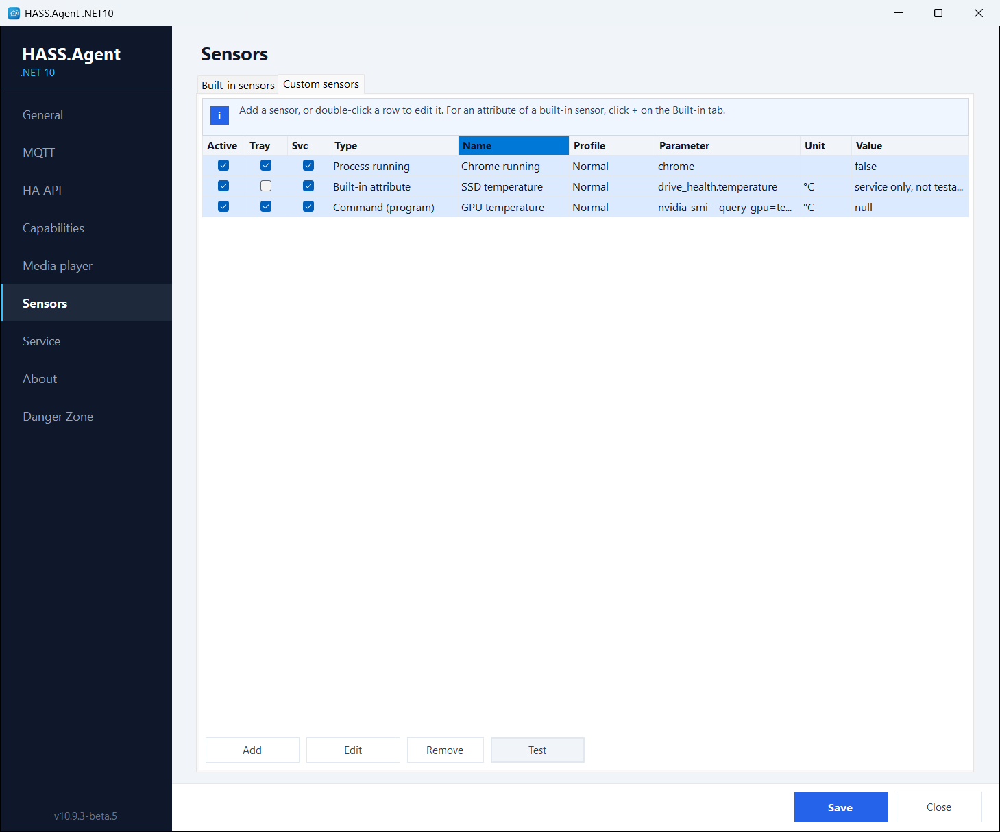
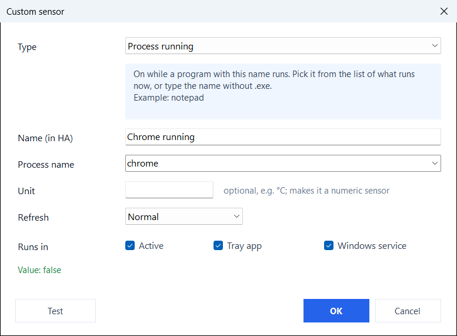

# Custom sensors

Custom sensors are parameterized sensors you can add as many times as you like, with different settings. Each one has:

- **Type**: what kind of sensor it is
- **Name**: the entity name in Home Assistant
- **Parameter**: what to monitor (depends on the type)
- **Unit**: optional unit of measurement shown in Home Assistant; it marks the sensor as a numeric `measurement`, and a unit of °C, GB, MB/s, h, W, V, A or MHz brings the matching device class (temperature, data size, data rate, duration, power, voltage, current, frequency), so a °C sensor shows as °F where that is the custom and the unit can be changed on the entity (10.10.0+, integration 10.10.0+)
- **Profile**: the polling interval (fast / normal / hourly / startup)
- **Tray** and **Svc**: which role reads it

<figure class="shot" markdown>
{ width="700" }
<figcaption>The Custom sensors tab</figcaption>
</figure>

**Add**, or a double click on a row, opens the editor: it explains the chosen type, offers what the PC has (running processes, services, drives, built-in attributes, LibreHardwareMonitor values), and **Test** shows the value the sensor would report. Shift and Ctrl pick several rows in the list; **Remove** and **Test** then work on all of them (10.10.0+). A sensor only the service can read says so instead of a value.

<figure class="shot" markdown>
{ width="600" }
<figcaption>The sensor editor, with one-click value testing</figcaption>
</figure>

## `process_running`

Checks whether a Windows process is currently running.

| Field | Example |
|-------|---------|
| Parameter | `notepad` or `chrome.exe` |
| State | `true` / `false` |

The `.exe` extension is optional. The check uses `Process.GetProcessesByName()`, so it matches the process name without path.

**Use case**: trigger an automation when a specific application starts or stops.

```text
Name: "Chrome running"
Parameter: chrome
```

## `service_status`

Reads the status of a Windows service.

| Field | Example |
|-------|---------|
| Parameter | `Spooler` or `wuauserv` |
| State | `running`, `stopped`, `paused`, etc. |

Use the exact Windows service name (not the display name). You can find it in `services.msc` or with `Get-Service` in PowerShell.

**Use case**: monitor whether a critical service is running (database, backup agent, print spooler).

```text
Name: "Print Spooler"
Parameter: Spooler
```

## `disk_free`

Reports the free space on a drive in GiB. From 10.10.2 the built-in **Drive space** sensor does this for every drive, with the total, the used space and the percentages too (`drive_space.D.free_gb`), so this type is no longer offered for a new sensor; one made before keeps working and can still be edited.

| Field | Example |
|-------|---------|
| Parameter | `D` or `D:` or `D:\` |
| State | `123.4` (GiB) |

Any of the three formats work. The sensor reports as a numeric `measurement` with unit `GiB`.

**Use case**: alert when a data drive is running low on space.

```text
Name: "Data drive free"
Parameter: D
```

## `built_in_attribute`

Extracts a single value from a built-in sensor's attribute tree and exposes it as a standalone sensor entity.

This is the most powerful custom sensor type. Some built-in sensors (LAN IP, Active displays, GPU usage, Drive health, Event Log errors) return structured data with multiple values. The `built_in_attribute` type lets you drill into that structure and pull out one specific value.

| Field | Example |
|-------|---------|
| Parameter | `network_address.addresses[0].address` |
| State | `192.168.1.42` |

**Path syntax:** the parameter is a dot-separated path into the sensor's attribute JSON. Array elements use `[index]` notation:

```text
sensor_key.property.nested_property
sensor_key.array[0].property
sensor_key.array[0].nested[1].value
```

The editor's list offers every path this PC has, with the unit filled in when it picks one; [Sensor attributes](attributes.md) lists them by sensor. Some of the paths:

| Built-in sensor | Attribute path | Value |
|----------------|---------------|-------|
| LAN IP | `network_address.addresses[0].adapter` | Adapter name |
| LAN IP | `network_address.addresses[0].address` | IPv4 address |
| Active displays | `active_display.displays[0].name` | Display name |
| Active displays | `active_display.displays[0].width` | Width in pixels |
| Event Log errors | `event_log_errors_recent.events[0].provider` | Source |
| Event Log errors | `event_log_errors_recent.events[0].created_at` | Timestamp |
| Last shutdown reason | `last_shutdown_reason.reason` | Reason text |
| Last wake reason | `last_wake_reason.source` | What woke the machine |
| Last wake reason | `last_wake_reason.kind` | `modern_standby`, `sleep`, `hibernate` or `fast_startup` |
| Sleep blocked | `sleep_blocked.primary_blocker` | First holder that really blocks sleep |
| Sleep blocked | `sleep_blocked.blockers[0].name` | Holder (process, service or driver) |
| GPU usage | `gpu_usage.engines.3d` | 3D engine load (%) |
| GPU usage | `gpu_usage.memory_dedicated_gb` | Dedicated GPU memory in use (GB) |
| GPU usage | `gpu_usage.adapters[0].name` | Adapter name |
| GPU usage | `gpu_usage.adapters[0].usage` | This adapter's load (%) |
| GPU usage | `gpu_usage.adapters[1].engines.3d` | The second adapter's 3D engine load (%) |
| Memory usage | `memory_usage.total_gb` | Installed memory (GB) |
| System drive free | `system_drive.total_gb` | The system drive's size (GB) |
| Drive space | `drive_space.D.free_gb` | Free space on D: (GB) |
| Drive space | `drive_space.C.used_percent` | How full C: is (%) |
| Drive health | `drive_health.temperature` | The system drive's temperature (°C) |
| Drive health | `drive_health.drives[0].power_on_hours` | The first drive's power-on hours (h) |
| Drive health | `drive_health.drives[1].health` | The second drive's health |
| Audio sessions | `audio_sessions.apps[0].volume` | The first app's volume (%) |
| Camera in use | `camera_in_use.apps[0]` | App using the camera |
| Microphone in use | `microphone_in_use.apps[0]` | App using the microphone |

!!! tip "Auto-create from the built-in sensors"

    Sensors with attributes show a **+** button next to their name on the **Built-in sensors** tab. Clicking it creates a `built_in_attribute` custom sensor for **every** attribute path of that sensor this PC has, each a separate Home Assistant entity with its unit. Clicking **+** on **LAN IP** creates three custom sensors per adapter: adapter name, adapter description and IPv4 address; on **Drive health**, the temperature, the health, the power-on hours and the rest for every drive. Delete the ones you do not need from the Custom sensors tab.

**Example:** the second network adapter's IP address:

```text
Name: "Secondary adapter IP"
Parameter: network_address.addresses[1].address
```

**Example:** the system drive's temperature:

```text
Name: "SSD temperature"
Parameter: drive_health.temperature
Unit: °C
Svc: on
```

A custom attribute sensor can only be ticked for a role that reads its built-in sensor (the drive health for the service, the active window for the app); the other box is greyed. It refreshes the shared read at its own profile: see [Polling profiles](profiles.md).

## `lhm` (LibreHardwareMonitor)

Reads a hardware value from a running [LibreHardwareMonitor](https://github.com/LibreHardwareMonitor/LibreHardwareMonitor): CPU and GPU temperature, fan speed, voltage, load. The app has no vendor-specific hardware code of its own; LibreHardwareMonitor does the reading and the app asks it.

1. Run LibreHardwareMonitor and turn on **Options > Remote Web Server > Run** (port 8085 by default). Let it start with Windows if the sensor should always work.
2. Add a custom sensor of the type **LibreHardwareMonitor**. The **Sensor** field lists everything LibreHardwareMonitor reports, with the current value; picking one fills in the unit, and the name when it is empty.

- The parameter is LibreHardwareMonitor's own sensor id (e.g. `/amdcpu/0/temperature/2`).
- The value is null while LibreHardwareMonitor is not running.
- The **Connection...** button next to the field sets a different address or port (default `http://localhost:8085`), and the user name and password when LibreHardwareMonitor's web server is set to ask for them.
- No Home Assistant integration update is required.

```text
Name: "CPU temperature"
Type: LibreHardwareMonitor
Parameter: /amdcpu/0/temperature/2
Unit: °C
Profile: normal
State: 45.5 °C
```

## `command` / `command_powershell` / `command_pwsh`

Runs a program or PowerShell script and uses its **output** as the sensor value, for anything Windows has no built-in sensor for.

| Type | Parameter | Runs as |
|------|-----------|---------|
| **Command (program)** | A program or full command line (e.g. `nvidia-smi --query-gpu=temperature.gpu --format=csv,noheader,nounits`) | The executable directly (fast, no shell) |
| **Command (PowerShell)** | An inline command or a `.ps1` path | `powershell.exe -NoProfile -ExecutionPolicy Bypass` |
| **Command (PowerShell 7)** | Same as above | `pwsh.exe -NoProfile -ExecutionPolicy Bypass` |

- The **first non-empty line** of the output (trimmed, at most 255 characters) becomes the sensor state, so format your command to print a single value. A plain number is published as a numeric value.
- Set an optional **Unit** (e.g. `°C`) to show it in Home Assistant; a unit also marks the sensor as a numeric `measurement`, so Home Assistant keeps long-term statistics and graphs it.
- Each run has a timeout (about 10 s) so a hung command cannot stall reporting. Pick the **Normal** or **Hourly** profile, not Fast.
- **Security**: you define what runs; Home Assistant only reads the resulting value, it cannot send commands. A command sensor for the service needs an administrator's approval, since the service runs as SYSTEM: [Commands the service runs](../features/windows-service.md#commands-the-service-runs). No Home Assistant integration update is required for these.

```text
Name: "GPU temperature"
Type: Command (program)
Parameter: nvidia-smi --query-gpu=temperature.gpu --format=csv,noheader,nounits
Unit: °C
Profile: normal
State: 54 °C
```
