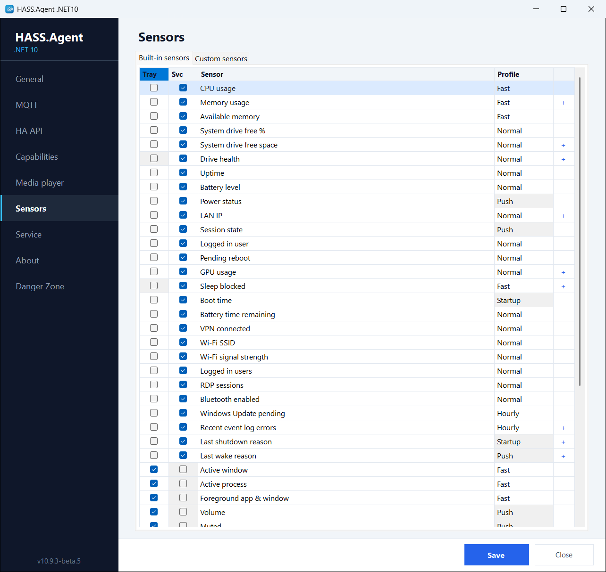

# Built-in sensors

The **Sensors** page has two tabs: **Built-in sensors** and **Custom sensors**.

Built-in sensors are predefined system metrics. Each one can be enabled or disabled on its own and assigned to the tray app, the service, or both. The **Profile** column is a choice too (10.10.0+): move a sensor to fast, normal or hourly as it suits the PC; the table below shows the defaults. Push-driven sensors (they report on change) and startup sensors keep theirs. [Polling profiles](profiles.md) says what the profiles mean.

The **Default** column shows whether a fresh install starts with the sensor switched on. Sensors that are useful, but not to everyone, start **off** so they do not clutter Home Assistant; enable them on the *Sensors* page. An update never changes a setting you already have: a sensor added by a new version simply arrives switched off.

<figure class="shot" markdown>
{ width="700" }
<figcaption>The Built-in sensors tab: a switch, the roles and the profile per sensor</figcaption>
</figure>

| Sensor | Profile | Service | Tray | Default |
|--------|---------|:---:|:---:|:---:|
| CPU usage | fast | yes | yes | on |
| GPU usage | normal | yes | yes | off |
| Memory usage | fast | yes | yes | on |
| Available memory | fast | yes | yes | on |
| System drive free % | normal | yes | yes | on |
| System drive free space | normal | yes | yes | on |
| Drive health | normal | yes | | on |
| Uptime | normal | yes | yes | on |
| Boot time | startup | yes | yes | on |
| Battery level | normal | yes | yes | on |
| Battery time remaining | normal | yes | yes | on |
| Power status | **push** | yes | yes | on |
| LAN IP | normal | yes | yes | on |
| Session state | **push** | yes | yes | on |
| Logged in user | normal | yes | yes | on |
| Logged in users (count) | normal | yes | yes | on |
| RDP sessions | normal | yes | yes | off |
| Pending reboot | normal | yes | yes | on |
| Sleep blocked | fast | yes | | off |
| VPN connected | normal | yes | yes | off |
| Wi-Fi SSID | normal | yes | yes | on |
| Wi-Fi signal | normal | yes | yes | on |
| Bluetooth enabled | normal | yes | yes | on |
| Windows Update pending | hourly | yes | yes | on |
| Recent Event Log errors | hourly | yes | yes | off |
| Last shutdown reason | startup | yes | yes | off |
| Last wake reason | **push** | yes | yes | off |
| Active window | fast | | yes | on |
| Active process | fast | | yes | on |
| Foreground app & window | fast | | yes | on |
| Volume | **push** | | yes | on |
| Muted | **push** | | yes | on |
| Monitor power state | **push** | | yes | on |
| Active displays | normal | | yes | on |
| Idle time | fast | | yes | on |
| Session locked | **push** | | yes | on |
| User present | **push** | | yes | on |
| Clipboard text available | fast | | yes | off |
| Camera in use | fast | | yes | off |
| Microphone in use | fast | | yes | off |
| Audio input device | **push** | | yes | off |
| Audio sessions | normal | | yes | off |
| Display brightness | **push** | | yes | off |
| Audio output device | **push** | | yes | on |
| Microphone muted | **push** | | yes | on |

A sensor the tray app cannot read (Drive health, Sleep blocked: both need administrator rights) has its Tray box greyed, and its **Test** says that it is read by the service only.

## Some of them, closer

- **Drive health** (10.10.0+): Windows' own verdict on the drives from their SMART data, `healthy`, `warning`, `unhealthy` or `unknown`, the worst among the drives as the value; every drive with its temperature, highest temperature, power-on hours and wear in the attributes. NVMe drives report the temperature, SATA drives when the controller passes it on, USB enclosures nothing. Needs the integration 10.10.0 or newer. Read by the service, since the Storage Management API wants an administrator.
- **GPU usage**: the busiest GPU's load as the value, with the engines (3D, video decode, copy), the dedicated and shared memory and every adapter in the attributes; `name` says which GPU the value follows. On a PC with two GPUs each has its own values under `adapters[N]`.
- **Camera in use / Microphone in use**: which apps use them, as `apps[N]`. Read from Windows' camera stack and from the apps recording on any input device, so they work on Windows 11 26H2 as well.
- **Session locked**, **User present**, **Idle time**: for "turn the lights off when nobody is at the PC" automations. *Session locked* reads the lock state Windows keeps for the session; *Idle time* is the seconds since the last keyboard or mouse input.
- **Sleep blocked**: whether a process, a service or a driver holds the PC awake, and which one, as Windows' `powercfg /requests` would tell.
- **Last wake reason**: what woke the PC and from which kind of sleep, with how long it was away. Follows the event log and is published with the next fast cycle.
- **Display brightness**, **Audio output device**, **Audio input device**, **Audio sessions**: the sensors behind the [display light, the audio selects and the per-app volume](../features/display-and-audio.md).

Sensors with structured values list them as attributes, and any attribute can become an entity of its own: [Attributes](attributes.md).

## Availability

The device publishes its online and offline state to Home Assistant: over MQTT with a **Last Will** message, over the HA API with a **heartbeat**. On a clean shutdown, a crash or a network loss, the entities turn **unavailable** in Home Assistant instead of keeping their last value. A sensor read by the service alone stays available while the service runs, with nobody logged in.

## In Home Assistant

Only the sensors switched on are sent. Each one is a `sensor` entity of the PC's device, with the device class its unit implies (Available memory and System drive free are data-size sensors, so their unit can be changed on the entity), and Home Assistant keeps long-term statistics for the numeric ones. An entity disappears when its sensor is switched off on both roles.
