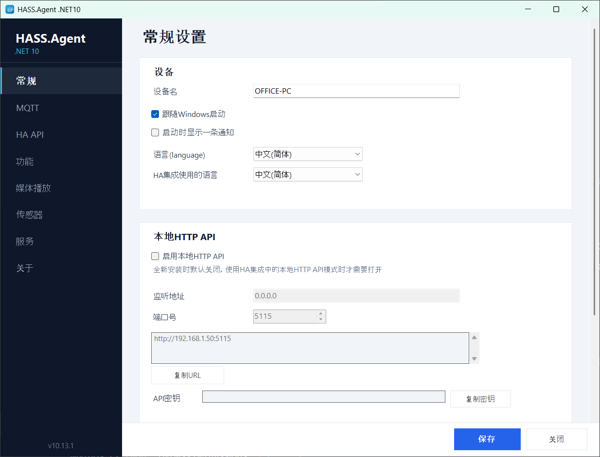

<div class="hero" markdown>

{ .logo }

<p class="eyebrow">.NET 10 · WINDOWS 10 / 11 · 支持简体中文</p>

# HASS.Agent .NET10

<p class="tag">现代、轻量的 Home Assistant Windows 伴侣应用：通知、媒体控制、传感器、指令和一键更新。</p>

[:material-download: 下载](https://github.com/v1k70rk4/HASS.Agent.NET10/releases/latest){ .md-button .md-button--primary }
[:material-rocket-launch: 快速入门（英文）](../getting-started/index.md){ .md-button }
[:material-github: GitHub](https://github.com/v1k70rk4/HASS.Agent.NET10){ .md-button }

或 `winget install v1k70rk4.HASSAgentNET10`

</div>

## 功能一览

在 Home Assistant 中查看和控制你的 Windows 电脑。应用在系统托盘中运行；还可以安装一个系统服务，处理无人登录时也需要工作的功能。

<div class="grid cards" markdown>

-   :material-bell-ring:{ .lg .middle } **通知**

    ---

    Home Assistant 的通知可以显示为 Windows 原生通知，也可以显示在应用自带的、始终可见的窗口中：支持图片、按钮和文字回复，回复会传回 Home Assistant。

-   :material-music:{ .lg .middle } **媒体播放**

    ---

    电脑上正在播放的内容会同步到 Home Assistant：播放、暂停、切歌、音量、封面。即使电脑静音，也能听到 TTS 语音播报。

-   :material-chart-line:{ .lg .middle } **传感器**

    ---

    内置系统传感器，也可以添加自己的：进程、服务、磁盘、脚本输出、LibreHardwareMonitor 的数值。

-   :material-lightning-bolt:{ .lg .middle } **指令**

    ---

    锁屏、睡眠、关机、重启，以及自定义按钮：程序、PowerShell 脚本、按键、链接。可在自动化或仪表盘中使用。

-   :material-dock-window:{ .lg .middle } **仪表盘**

    ---

    点击一下，Home Assistant 仪表盘就会显示在托盘上方的小窗口中。也可以把任意页面显示在独立窗口里，比如门铃响起时的摄像头画面。

-   :material-keyboard:{ .lg .middle } **组合键**

    ---

    给一组按键起个名字，它就会成为 Home Assistant 中的一个事件：用键盘就能触发任意自动化。

-   :material-update:{ .lg .middle } **在 Home Assistant 中更新**

    ---

    更新实体带有真正的 **安装** 按钮。安装系统服务后，更新会在后台静默完成，并且只运行带有发布者签名的安装包。

-   :material-shield-check:{ .lg .middle } **安全**

    ---

    电脑不需要管理员令牌：它使用自己的、非管理员的 Home Assistant 用户。每个版本都经过签名，应用不含任何遥测。

</div>

## 支持简体中文

应用界面提供简体中文：在中文版 Windows 上会自动以中文启动，否则可以在 **常规** 页面的 **语言(language)** 中选择。Home Assistant 中实体名称的语言可以单独设置（**HA集成使用的语言**）。

<figure class="shot" markdown>
{ width="700" }
<figcaption>简体中文的“常规”页面</figcaption>
</figure>

## 三步完成安装

需要 Windows 11 或 Windows 10（2004 或更高版本，x64）、Home Assistant 2026.6 或更高版本，以及 MQTT 代理服务器 **或** Home Assistant 的 WebSocket API。使用 API 不需要代理服务器，在外也能连接，例如通过 Nabu Casa。

1. **集成。** 在 Home Assistant 的 **设置** 中打开 **Marketplace**（2026.11 之前的 Home Assistant 中是 HACS），搜索 **HASS.Agent** 集成，下载并重启 Home Assistant。

    [](https://my.home-assistant.io/redirect/hacs_repository/?owner=v1k70rk4&repository=HASS.Agent.NET10-Integration&category=integration)

2. **Windows 应用。** 使用 winget 安装，或从[发布页面](https://github.com/v1k70rk4/HASS.Agent.NET10/releases/latest)下载已签名的安装包：

    ```powershell
    winget install v1k70rk4.HASSAgentNET10
    ```

    应用常驻系统托盘：点击图标即可打开设置。

3. **连接。** 在 **MQTT** 页面填写代理服务器地址和登录信息，或者在 **HA API** 页面填写 Home Assistant 地址和长期访问令牌。使用 MQTT 时，电脑会自动出现在 Home Assistant 的 **设备与服务** 页面的已发现设备中。使用 HA API 时，第一台电脑需要通过添加集成来加入（**HASS.Agent → HA API (WebSocket)**），之后的电脑 Home Assistant 会自动发现。

## 更多内容

详细文档为英文：

- [Get started](../getting-started/index.md)：详细的安装步骤
- [Features](../features/index.md)：全部功能，附截图
- [Connection modes](../connection/index.md)：MQTT、HA API，或两者并用
- [Coming from HASS.Agent](../getting-started/migrating.md)：从原版 HASS.Agent 迁移
- [Translating](../translating.md)：帮助改进翻译

本应用免费、开源（MIT 许可证），与 Home Assistant 项目没有关联。
